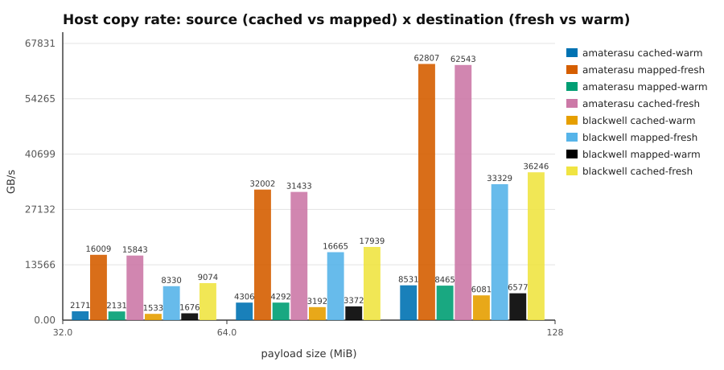
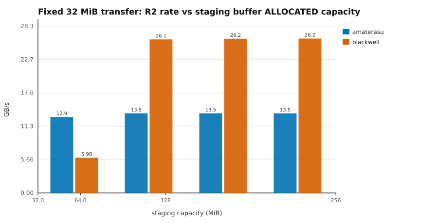
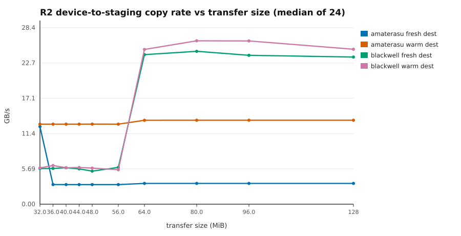
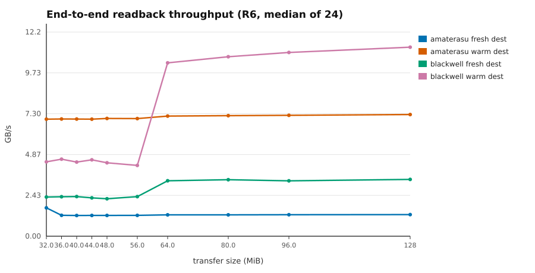

# Phase 7 — WGPU timestamp and readback-path instrumentation

**Date:** 2026-08-27
**Base commit:** `9fa0a806db717909a23e472965bd81be3a2ab4f5` (tree `09ec242eaec4bb8f3093ca311d537b18b7df1e9d`)
**Character:** diagnostic measurement. No production optimization was implemented.

---

## 1. Summary

Phases 1–6 established that device-to-host readback dominates GPU wall time
(86–95 %) and that the rate collapsed somewhere around 41–51 MiB on one host.
Neither the kernel time nor the readback stages had ever been measured
separately — every number was a host-side wall clock around the whole
operation. Phase 7 built the instrument and measured them.

Four results, each isolated by a discriminating experiment rather than inferred:

1. **The kernel is now separable from the dispatch.** GPU timestamp queries are
   granted on both hosts. Submit-plus-completion overhead is **65–150 µs**,
   roughly constant, not proportional to work.

2. **The readback bottleneck was never the transfer.** It is the *host
   destination allocation*. Copying into a freshly allocated `Vec` runs at
   3.7–4.0 GB/s (Blackwell) and 2.1 GB/s (amaterasu); copying the same bytes
   from the same mapped range into a preallocated buffer runs at **20–22 GB/s
   and 15.7 GB/s** respectively. The mapped range is not slow — reading it is a
   full-rate DRAM read.

3. **The 41–51 MiB "cliff" on amaterasu was an artifact of that allocation
   churn**, and it disappears completely when the destination is reused: flat
   12.9–13.5 GB/s across 32–128 MiB instead of a collapse to 3.16 GB/s.

4. **Blackwell has a genuine, unrelated discontinuity** that is *not* removed by
   destination reuse: the device-to-staging copy runs 4.4× faster when the
   staging buffer was **allocated** with ≥ 64 MiB capacity — even for a 32 MiB
   transfer. Copy granularity is irrelevant; allocated capacity governs.

End-to-end readback improves **4.1–5.7× on amaterasu and 1.9–3.3× on
Blackwell** from destination reuse alone. Three prior conclusions are corrected
in §10; the corrections are additive and the original text remains in place.

---

## 2. What was built

| file | change | lines |
|---|---|---:|
| `hymeko_wgpu/src/profiling.rs` | new — `GpuTimer`, `ElapsedTicks`, `TimestampSupport`, `StagingBuffer`, `ReadbackPlan`, `ReadbackTiming`, `timed_readback` | +761 |
| `hymeko_wgpu/tests/profiling_readback.rs` | new — 6 focused tests | +295 |
| `hymeko_wgpu/examples/phase7_probe.rs` | new — probe parts A, B, C, D, E, F | +598 |
| `hymeko_wgpu/src/operations/spmm.rs` | `encode_into` threads `Option<ComputePassTimestampWrites>`; `pub(crate) encode_with_timestamps` on the tracked scope | +32 −4 |
| `hymeko_wgpu/src/backend.rs` | `DeviceCapabilities::timestamp_inside_encoders` | +8 |
| `hymeko_wgpu/src/lib.rs` | `#[doc(hidden)] pub mod profiling` | +2 |
| `scripts/tsv_to_svg.awk` | new — one reusable chart generator (no plotting tooling existed) | +115 |

`hymeko_core` and `hymeko_hnn` are untouched — verified by `git status`, not by
timestamp. No new dependencies. No `unsafe`. CUDA remains an external optional
tool and is not a Rust dependency.

**Overhead on the non-profiled path.** `encode_into` is private with exactly two
callers; both public `encode` methods pass a literal `None`, which is
byte-for-byte the value the descriptor field previously carried. There is no
runtime mode flag and no new branch. Note the honest limit: this harness has a
known ~5 % order bias (Phase 5), so a benchmark *cannot* resolve a sub-1 %
change. The claim rests on the code shape, not on a measurement that could not
have detected a violation anyway.

---

## 3. Measurement boundaries

Stated exactly, because every earlier ambiguity in this project came from
comparing spans that were not the same span.

**Kernel (Part A)**

| symbol | span |
|---|---|
| K1 | host `Instant`: before encode → after `submit_and_wait` returns |
| K2 | GPU timestamps written immediately before and after the compute pass, resolved from the query set, scaled by `Queue::get_timestamp_period()` |
| K3 | CUDA `cudaEvent` pair around kernel launches only (Phase 6, external) |

**Readback (Parts B, D, E, F)**

| symbol | span |
|---|---|
| R1 | staging buffer creation (zero when reused) |
| R2 | GPU timestamps around `copy_buffer_to_buffer`, inside the encoder |
| R3 | host: `submit` → `wait` returns |
| R4 | host: `map_async` issued → its callback has fired |
| R5 | host: `get_mapped_range()` → destination filled |
| R6 | host: the whole call, measured independently end to end |

R6 is measured on its own clock and is **not** the sum of R1–R5; the residual is
left visible rather than distributed into the components.

**Rejection rule, fixed before any result was read:** the first 3 repetitions of
every cell are discarded; a timestamp pair whose end is not greater than its
begin is discarded as unusable and counted. Nothing else is rejected — choosing
an outlier filter after seeing data is how a desired answer gets manufactured.
Zero pairs were discarded in any run reported here.

Every comparison is **paired and alternating** (A/B, B/A, …), 24 steady
repetitions per cell, median reported, IQR retained. Seed `0x005E_EDC0_FFEE`.

---

## 4. Part A — kernel time vs host wall time

200 000 rows, uniform degree, nnz 1 599 965 (deg 8) / 6 399 519 (deg 32).

| host | deg | fd | K1 (µs) | K2 (µs) | K1−K2 (µs) | K2 GMAC/s |
|---|---:|---:|---:|---:|---:|---:|
| amaterasu | 8 | 8 | 512.8 | 433.8 | 79.0 | 29.5 |
| amaterasu | 8 | 32 | 1 379.6 | 1 297.0 | 82.7 | 39.5 |
| amaterasu | 8 | 128 | 4 179.0 | 4 053.8 | 125.2 | 50.5 |
| amaterasu | 32 | 32 | 5 649.1 | 5 343.3 | 305.8 | 38.3 |
| Blackwell | 8 | 8 | 111.6 | 47.1 | 64.5 | 271.5 |
| Blackwell | 8 | 32 | 259.6 | 184.5 | 75.1 | 277.5 |
| Blackwell | 8 | 128 | 1 347.1 | 1 196.1 | 151.0 | 171.2 |
| Blackwell | 32 | 32 | 668.8 | 569.9 | 98.9 | 359.3 |

Submit-plus-completion overhead is **65–150 µs** and roughly flat, consistent
with the ~80 µs submit floor Phase 3 measured independently. It is therefore a
large fraction of a small kernel (2.37× at deg 8/fd 8 on Blackwell) and
negligible for a large one (1.03× at fd 128 on amaterasu). The deg-32 amaterasu
cell at 305.8 µs is the one value not explained by a flat floor and is left as
an open item.

### 4.1 K2 vs K3 — the first legitimate kernel comparison

Phase 6 explicitly refused to divide CUDA's kernel time by wgpu's resident time
because the spans differed. With K2 that comparison becomes valid. Equivalence
preconditions checked before computing anything:

| precondition | status |
|---|---|
| generator, nnz | 1 599 965 both — exact match |
| rows, cols, degree, fd, distribution | 200 000 × 200 000, deg 8, fd 32, uniform — identical |
| warm-up | CUDA 5 discarded, wgpu 3 discarded — both warm |
| repetitions / statistic | CUDA 50, wgpu 24; median both |
| span | both kernel-only GPU-timeline intervals |
| correctness | both validated against the CPU oracle |
| hardware | same GPU (amaterasu, RTX 2070 SUPER) |

| measurement | value |
|---|---:|
| CUDA kernel only (K3) | 920.9 µs |
| wgpu kernel only (K2) | 1 297.0 µs |
| **ratio** | **1.41×** |

This also **re-attributes** Phase 6's unexplained 495 µs gap:

| term | µs | share |
|---|---:|---:|
| session creation (Phase 6 span minus K1) | 36.6 | 7 % |
| submit + completion (K1 − K2) | 82.6 | 17 % |
| **kernel itself (K2 − K3)** | **376.1** | **76 %** |

Phase 6 could not rule out that dispatch overhead dominated that gap. It does
not: three quarters of it is the kernel being slower. This does not identify
*why* — WGSL codegen, occupancy and scheduling are all untested here.

---

## 5. Part B — readback stage decomposition

Median of 24 steady repetitions, reused staging, fresh destination (the shape
all earlier phases used). Full 56-cell tables are in the raw TSVs.

**Blackwell**, 128 MiB: R1 0.1 µs · R2 5 662.7 · R3 6 159.6 · R4 14.1 ·
**R5 33 437.1** · R6 39 678.3 µs. R5 is **84 %** of the total.
**amaterasu**, 128 MiB: R1 0.1 · R2 40 075.3 · R3 40 871.2 · R4 3.5 ·
**R5 63 520.3** · R6 104 350.7 µs. R5 is **61 %**.

R5 is almost perfectly linear in size — 4.01 GB/s on Blackwell and 2.11 GB/s on
amaterasu, constant across 32–128 MiB. That flat, low rate is the anomaly Parts
D–F were built to explain: it is far below either host's DRAM bandwidth.

R1 (fresh staging allocation) is a fixed cost independent of size: ~4.3 ms on
Blackwell, ~18.3 ms on amaterasu. Staging reuse removes it entirely and is worth
~10 % end to end on Blackwell and ~2× at 32 MiB on amaterasu.

---

## 6. Part D — the discriminating experiment

R5 as originally written included allocating the destination `Vec`, so it could
not distinguish a slow *source* from a faulting *destination*. This was a defect
in my own instrument, found while interpreting Part B rather than before. The
2×2 below holds bytes, process and timer boundary fixed and varies only source
(ordinary cached `Vec` vs the mapped staging range) and destination (freshly
allocated vs preallocated and resident). Median GB/s of 12:

| host | size | cached→fresh | cached→warm | mapped→fresh | mapped→warm |
|---|---:|---:|---:|---:|---:|
| Blackwell | 32 MiB | 3.70 | 21.88 | 4.03 | 20.02 |
| Blackwell | 64 MiB | 3.74 | 21.02 | 4.03 | 19.90 |
| Blackwell | 128 MiB | 3.70 | 22.07 | 4.03 | 20.41 |
| amaterasu | 32 MiB | 2.12 | 15.45 | 2.10 | 15.74 |
| amaterasu | 64 MiB | 2.13 | 15.58 | 2.10 | 15.63 |
| amaterasu | 128 MiB | 2.15 | 15.73 | 2.14 | 15.86 |

**The source column makes no difference; the destination column is the entire
effect** — 5.4× on Blackwell, 7.4× on amaterasu. The mapped staging range reads
at full DRAM rate. My leading hypothesis going in (a write-combined / uncached
mapping) is *refuted*: mapped is marginally **faster** than cached in three of
six rows.

The cost is allocating and first-touching the destination. It replicates across
two operating systems, two GPU architectures and two allocators.

---

## 7. Parts E and F — what governs the size discontinuity

### 7.1 Chunking is irrelevant (Part B)

Splitting a transfer into 8 or 16 MiB `copy_buffer_to_buffer` calls within one
encoder and one submit changes R2 by less than 2 % at every size on both hosts —
16 × 8 MiB behaves exactly like 1 × 128 MiB. Per-copy size does not govern.

### 7.2 On Blackwell, allocated capacity governs (Part E)

Transfer fixed at 32 MiB, destination warm, only the staging buffer's allocated
capacity varied:

| staging capacity | Blackwell R2 | amaterasu R2 |
|---:|---:|---:|
| 32 MiB | 5.98 GB/s | 12.89 GB/s |
| 64 MiB | **26.07 GB/s** | 13.51 GB/s |
| 128 MiB | 26.18 GB/s | 13.51 GB/s |
| 256 MiB | 26.22 GB/s | 13.51 GB/s |

The identical 32 MiB transfer is **4.4× faster** purely because the buffer was
allocated larger. On amaterasu capacity is flat — the effect is host-specific.

### 7.3 On amaterasu, destination churn governs (Part F)

Part B's sweep re-run with the destination preallocated, everything else
identical. R2, GB/s:

| MiB | amaterasu fresh dest | amaterasu warm dest | Blackwell fresh dest | Blackwell warm dest |
|---:|---:|---:|---:|---:|
| 32 | 12.50 | 12.89 | 5.74 | 5.85 |
| 36 | **3.17** | **12.89** | 5.76 | 6.23 |
| 40 | 3.16 | 12.89 | 5.87 | 5.87 |
| 48 | 3.16 | 12.90 | 5.32 | 5.82 |
| 56 | 3.16 | 12.90 | 5.93 | 5.55 |
| 64 | 3.35 | 13.52 | **24.09** | **24.92** |
| 96 | 3.35 | 13.53 | 23.98 | 26.29 |
| 128 | 3.35 | 13.53 | 23.70 | 24.95 |

On amaterasu the cliff **vanishes**. On Blackwell the step at 64 MiB is
**unchanged**. Two different mechanisms, cleanly separated.

The amaterasu transition sits between 32 and 36 MiB. glibc's
`DEFAULT_MMAP_THRESHOLD_MAX` is exactly 32 MiB on 64-bit (glibc 2.39 confirmed
on that host): above it every allocation is `mmap`/`munmap`ed and the kernel
must supply freshly zeroed pages each time, and that zeroing competes for the
memory bandwidth the DMA needs. The threshold coincidence and the fact that
holding the destination fixed removes the effect entirely both support this.
It is **not** proven — the discriminating test would be to re-run with
`M_MMAP_THRESHOLD` raised via `mallopt`, which was not done. Recorded as a
supported hypothesis, not as an established cause.

### 7.4 End-to-end effect

| MiB | amaterasu before | after | speedup | Blackwell before | after | speedup |
|---:|---:|---:|---:|---:|---:|---:|
| 32 | 1.69 | 6.97 | 4.12× | 2.34 | 4.43 | 1.90× |
| 48 | 1.24 | 7.02 | 5.66× | 2.23 | 4.37 | 1.96× |
| 64 | 1.27 | 7.16 | 5.63× | 3.30 | 10.33 | 3.13× |
| 128 | 1.29 | 7.25 | 5.64× | 3.38 | 11.26 | 3.33× |

Blackwell at 128 MiB reaches **11.26 GB/s**, against CUDA's measured
10.86–11.16 GB/s on amaterasu. Different hosts, so not a like-for-like
comparison — but it removes the impression that the wgpu readback path is
inherently several times slower than CUDA's.

---

## 8. Part C — order bias

Pooled over all sizes, 168 paired samples per group, percentile bootstrap,
2 000 resamples, seed 20260827:

| host | variant | median first | median second | shift | 95 % CI |
|---|---|---:|---:|---:|---|
| amaterasu | fresh | 58 032.4 µs | 57 998.8 µs | −0.06 % | [−4.54 %, +5.37 %] |
| amaterasu | reused | 41 908.6 µs | 42 158.4 µs | +0.60 % | [−6.51 %, +8.27 %] |
| Blackwell | fresh | 21 533.4 µs | 21 784.1 µs | +1.16 % | [−3.75 %, +5.47 %] |
| Blackwell | reused | 21 866.4 µs | 21 868.1 µs | +0.01 % | [−6.34 %, +8.81 %] |

Every interval contains zero: **no detectable order bias**. The intervals are
wide (±5–8 %) because pooling sizes that differ 4× in magnitude inflates
dispersion; the design is balanced, so the point estimates remain valid. Every
effect reported above (1.9×–7.4×) lies far outside these bounds.

---

## 9. Hypotheses

| # | hypothesis | prediction | observed | verdict |
|---|---|---|---|---|
| H1 | Fresh staging allocation is a significant cost | R1 large and size-independent | 4.3 ms (Blackwell) / 18.3 ms (amaterasu), flat in size | **supported** |
| H2 | Map completion latency is significant | R4 material | R4 = 3–23 µs everywhere, < 0.1 % of R6 | **contradicted** |
| H3 | The GPU-side copy is the bottleneck | R2 dominates R6 | R2 is 14–38 % of R6; R5 is 61–84 % | **contradicted** |
| H4 | The host copy dominates because the mapped range is uncached/WC | mapped→warm ≪ cached→warm | 20.0 vs 21.9 (Blackwell), 15.7 vs 15.5 (amaterasu) — no difference | **contradicted** |
| H4′ | The host copy dominates because of destination allocation | fresh ≪ warm regardless of source | 5.4× / 7.4×, source-independent | **supported** |
| H5 | There is a size-dependent driver/allocator transition | discontinuity in R2 | yes, and host-specific: capacity-keyed on Blackwell, churn-keyed on amaterasu | **supported, mechanism partly open** |
| H6 | Chunking the copy recovers the fast path | chunked > single above threshold | < 2 % difference at every size, both hosts | **contradicted** |

H4 was my leading hypothesis and it is wrong. H4′ replaced it only because the
2×2 was run instead of stopping at a plausible story.

---

## 10. Corrections to earlier reports

Per standing instruction the original text stays; these are additive.

**10.1 — `2026-08-25-published-baseline-benchmark.md`, Appendix B.** The
"readback cliff at 41–51 MiB" on amaterasu is now attributed to host destination
allocation churn, not to the GPU or the driver's transfer path. With a
preallocated destination the rate is flat 12.9–13.5 GB/s across 32–128 MiB. The
appendix's "observed, not explained" wording was correct and is retained; the
explanation belongs here.

**10.2 — `2026-08-27-phase6-cuda-feasibility.md`, §5.** That section correctly
declined to compute a CUDA-vs-wgpu kernel ratio because the spans differed, and
noted a ~495 µs unexplained difference. Phase 7 supplies the missing span (K2)
and attributes it: 7 % session creation, 17 % submit/completion, **76 % the
kernel itself**. The legitimate kernel ratio is **1.41×**.

**10.3 — the CUDA readback comparison was not like-for-like.** The CUDA
prototype allocates `std::vector<float> host(y_elems)` once, outside its timing
loop, value-initialized and therefore fully page-resident, then reuses it for
all 10 repetitions. The wgpu path allocated a fresh `Vec` on every readback. The
reported "CUDA 10.86–11.16 GB/s vs wgpu ~2.4 GB/s" gap was substantially a
warm-destination-vs-fresh-allocation asymmetry, not an API property. With the
destination held equal, wgpu reaches 11.26 GB/s. This was my measurement error,
not a CUDA or wgpu behaviour.

---

## 11. Decision gate

**Chosen: B — staging and destination buffer reuse, implemented in a later
phase.** Not implemented in Phase 7, per the brief.

- **A (no change justified)** — rejected. The measured end-to-end gain is
  1.9–5.7×, far outside this harness's ±5 % noise floor and reproduced on two
  hosts.
- **B (buffer reuse later)** — **chosen.** Two measured, additive wins: staging
  reuse removes R1 (4.3 ms / 18.3 ms fixed); destination reuse removes the
  dominant R5 penalty (5.4× / 7.4×). The dominant term is the *destination*, so
  the API change is a readback that fills a caller-supplied buffer — the seam
  `ReadbackPlan::dest` already prototypes. Scope note: this is an API addition,
  not a `ReadbackPool`, and it must not weaken arena provenance or `TensorOperand`
  sealing; a pooled-buffer design would need the same lifetime discipline
  `TensorArena` already carries.
- **C (chunked readback later)** — rejected on evidence. Chunking changes R2 by
  < 2 % at every size on both hosts. It would add code for no measured benefit.
- **D (investigate further)** — partially retained as follow-up, not as the
  decision. Two mechanisms remain unproven: the glibc `mmap` threshold
  hypothesis (§7.3) and Blackwell's capacity threshold (§7.2). Neither blocks B.

Blackwell's capacity effect suggests rounding staging allocations up to ≥ 64 MiB,
but that is **host-specific and must not be defaulted globally** — it is flat on
amaterasu, and a naive "always allocate large" policy is unvalidated on any third
device. It needs its own measured decision.

---

## 12. Tests and gates

| gate | result |
|---|---|
| `cargo fmt --all --check` | pass |
| `cargo clippy --workspace --all-targets -- -D warnings` | pass, 0 warnings |
| `cargo build --release` | pass |
| workspace tests | 152 passed, **1 pre-existing failure** |
| `hymeko_wgpu` tests (unit + integration) | 114 passed, 0 failed |
| `hymeko_wgpu` doctests | 17 passed, 0 failed (131 total with the above) |
| bench smoke (`spmm_bench`) | runs clean, 0 errors |

The single workspace failure is the known
`test_load_meta_geometry` 57/58 fixture drift in `hymeko_core`. It is
pre-existing, unrelated to Phase 7 (no Phase 7 file touches `hymeko_core`), and
per the brief was left untouched and unsilenced.

The bench smoke was run at `--measurement-time 3 --sample-size 10` against a
criterion baseline recorded with default settings, so its reported deltas
compare *configurations*, not before-and-after. They are also `spmm_cpu` cells,
which Phase 7 does not touch. It is a "does it run" gate here and nothing more.

New tests in `hymeko_wgpu/tests/profiling_readback.rs`:

1. timer exists iff `TIMESTAMP_QUERY` is granted (covers the unsupported branch)
2. query index and resolve-count bounds, including exactly-at-capacity
3. byte correctness across fresh / reused / three chunk sizes
4. destination reuse fills the buffer, truncates it, returns empty
5. zero-length and non-chunk-multiple (3 145 733 element) payloads
6. ten consecutive reuses stay correct and leave the buffer unmapped

Plus 6 pure unit tests in `profiling.rs` for tick conversion, wrap/out-of-order
rejection, capability classification and throughput accounting.

**Serial execution required.** These construct a device per test; concurrent
`WgpuBackend` creation deadlocks in the Vulkan loader on Linux (diagnosed in
Phase 5). Run with `--test-threads=1`.

---

## 13. Provenance

| | Blackwell | amaterasu |
|---|---|---|
| GPU | RTX 5080 Laptop, driver 610.88 | RTX 2070 SUPER, driver 595.91.07 |
| CPU | Intel Core Ultra 9 275HX | AMD Ryzen 7 3700X |
| RAM | 63.4 GB | 31 GB |
| OS | Windows 11 Home | Linux 7.0.0-28-generic, glibc 2.39 |
| timestamps | `PassesAndEncoders`, period 1 ns | `PassesAndEncoders`, period 1 ns |

rustc 1.97.1 (local) / 1.98.0 (amaterasu); wgpu 30.0.1; seed
`0x005E_EDC0_FFEE`; 3 warm-up + 24 steady repetitions per cell; 0 timestamp
pairs discarded. Raw TSVs for parts A/B/D/E/F on both hosts are retained in the
session scratchpad; the aggregates in this report are reproducible from them
with `scripts/tsv_to_svg.awk` and the aggregation scripts alongside.

---

## 14. Mistakes and false assumptions found

Recorded because the diagnostic value is in what was wrong, not what was right.

1. **R5 was a confounded measurement of my own making.** It timed
   `get_mapped_range()` + `to_vec()` together, so source cost and destination
   allocation were inseparable. Found while interpreting Part B, not before
   running it. Everything in §6–§7 depends on having split it.
2. **My leading hypothesis (H4, write-combined mapping) was wrong.** Refuted by
   the 2×2, which showed the mapped source is marginally *faster* than a cached
   one. Had I stopped at the plausible story, the report would have blamed the
   mapping and recommended a useless fix.
3. **My prediction for amaterasu Part E was wrong.** I predicted a large staging
   buffer would make a small transfer slow there, by analogy with Blackwell. It
   is flat. The two hosts do not share a mechanism, and the analogy was the
   error.
4. **The Phase 6 CUDA readback comparison was not like-for-like** (§10.3) — my
   measurement asymmetry, carried into a published report.
5. **A display-pipeline bug briefly lost 10 of 56 aggregate rows** (`head -1` on
   a pipe consumes a whole buffered block, starving the following `tail`). Caught
   by checking raw row counts before interpreting. Measurements were unaffected;
   had it gone unchecked it would have silently dropped cells from the tables.
6. **`encode_with_timestamps` was initially added to both scopes**, leaving the
   untracked one dead and failing `-D warnings`. The profiling probe goes through
   a session, so only the tracked variant was ever reachable.

---

## 15. Open items

* Blackwell's ≥ 64 MiB capacity threshold — mechanism unidentified; likely a
  `gpu-allocator` dedicated-vs-suballocated decision, untested.
* The glibc `mmap` threshold hypothesis needs a `mallopt(M_MMAP_THRESHOLD, …)`
  run to move from supported to established.
* The amaterasu deg-32 cell's 305.8 µs submit overhead does not fit the flat
  65–150 µs floor seen elsewhere.
* K2 vs K3 gives 1.41×; *why* the WGSL kernel is slower (codegen, occupancy,
  scheduling) is untouched.
* No third GPU vendor tested. Both hosts are NVIDIA/Vulkan; an AMD or Intel
  adapter could show a third pattern.
