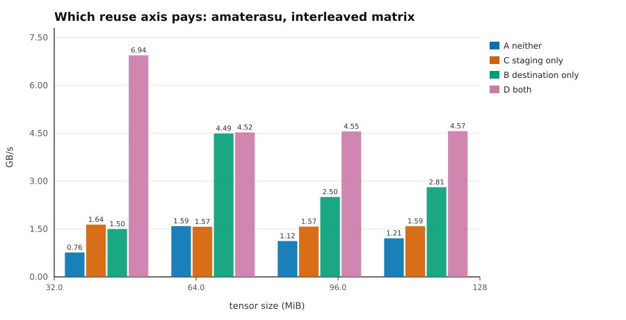
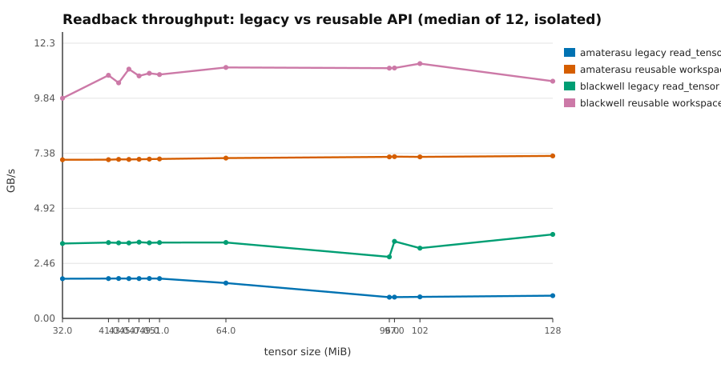
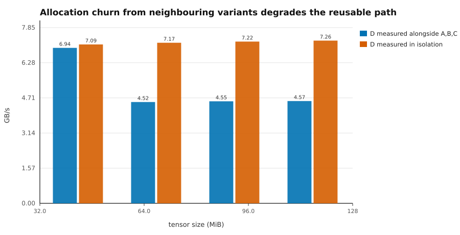

# Phase 8 — production readback reuse

**Date:** 2026-08-27
**Base commit:** `4952b999549ced32d43bd8b7e9ac2526199b9fab` (tree `843c88ef257aaf1e6a7dbdafc6d6f92d3ff802ae`)
**Character:** production API, built on the Phase 7 measurement result.

---

## 1. Summary

Phase 7 established that readback wall time is dominated not by the transfer but
by **allocating the host destination**, with staging allocation a second, fixed
cost. Phase 8 turns that into a small public API and re-measures it end to end
through the shipped code.

`ReadbackWorkspace` is the explicit carrier of the two reusable buffers. It is
deliberately **not** a second readback path: the legacy `read_tensor`, the new
`read_tensor_into` and the diagnostic probe all reach the same engine, and the
map / mapped-range-validation / byte-copy / unmap steps now exist exactly once
in the crate.

Measured through the production API, on isolated runs:

| host | legacy `read_tensor` | reusable workspace | speedup |
|---|---:|---:|---:|
| amaterasu (RTX 2070 SUPER, Linux) | 0.95–1.78 GB/s | **7.09–7.27 GB/s** | **4.00×–7.61×** |
| Blackwell (RTX 5080 Laptop, Win 11) | 2.75–3.75 GB/s | **9.84–11.39 GB/s** | **2.83×–4.07×** |

The reusable path is **flat across size** on both hosts. The Phase 7 cliff — the
one that motivated all of this — is gone from the production path, not worked
around.

Three things went wrong along the way and are recorded in §11: my own benchmark
contaminated its own measurement, an ambient-load hypothesis was refuted, and a
`compile_fail` doctest had to be proved to fail for the right reason.

---

## 2. Phase 0 — duplication map (recorded before implementation)

Every implementation of the eight steps, as found on `origin/main`:

| step | `backend.rs::read_tensor` | `profiling.rs::timed_readback` | `profiling.rs::GpuTimer::read` | classification |
|---|---|---|---|---|
| 1 shape / byte validation | :344–360 | caller-supplied `bytes` | fixed `count × 8` | production mechanism |
| 2 staging allocation | :361 | `StagingBuffer::new` | own buffer, once | production mechanism |
| 3 copy encoding | :364 | :539 single, :546 chunked | `resolve_query_set` | mechanism + measurement-only |
| 4 submit + wait | :365–366 | :74–75 | — | production mechanism |
| 5 `map_async` + poll | :369–384 | :573–591 | :295–312 | production mechanism |
| 6 mapped-range validation | :396–401 | :601–606 | :314–319 | production mechanism |
| 7 bytes → host buffer | :402 | :607–620 | :320 | production mechanism |
| 8 unmap | :404 | :624 | :322 | production mechanism |

Steps 5–8 were written **three times**, byte-for-byte equivalent and drifting
independently. Steps 1–4 were written twice. `StagingBuffer` (profiling) and the
inline `staging_buffer` call (backend) were two expressions of one ownership
policy. Test and bench helpers held no readback logic of their own — they called
one of the three above — so nothing had to be deduplicated there.

---

## 3. Architecture and public API

```text
  WgpuBackend::read_tensor        legacy, owns a temporary workspace
  WgpuBackend::read_tensor_into   reusable, caller owns the workspace
  profiling::timed_readback       shares every step, own clocks between
  GpuTimer::read                  shares steps 5-8, u64 payload
           |            |            |            |
           +------------+------------+------------+
                        v
                 readback_into()            steps 1-8, one implementation
                        |
        +---------------+---------------+
        v                               v
   map_blocking()               drain_mapped_into<T>()
   (step 5)                     (steps 6,7,8 - unmaps on every path)
```

Public surface added:

```rust
let mut ws = backend.create_readback_workspace();
let values: &[f32] = backend.read_tensor_into(&tensor, &mut ws)?;
```

| item | purpose |
|---|---|
| `ReadbackWorkspace` | owns reusable staging + destination |
| `WgpuBackend::create_readback_workspace()` | constructor bound to a backend |
| `WgpuBackend::read_tensor_into(&op, &mut ws) -> &[f32]` | the reusable read |
| `ReadbackWorkspace::reserve(&backend, elements)` | optional pre-sizing |
| `ReadbackWorkspace::take_result() -> Vec<f32>` | surrender the buffer, keep staging |
| `staging_capacity()`, `staging_allocations()`, `destination_capacity()` | structural introspection, for tests |
| `StagingStorage` | grow-only device staging (also the probe's type) |

**Naming deviation.** The brief suggested `read_tensor_reuse`. The chosen name is
`read_tensor_into`, because this workspace already uses `_into` for exactly this
meaning — "write into caller-owned storage instead of allocating" — in
`spmv_into`, `spmm_into` (core) and `encode_into` (wgpu). `_reuse` would have
been a third word for an established concept.

No raw `wgpu::Buffer` accessor was added to `ArenaTensor`. Arena tensors read
back through the sealed `TensorOperand` trait exactly as before; a test asserts
it (§7).

---

## 4. Semantics

**Ownership and lifetime.** The workspace is an ordinary owned value. It borrows
nothing at rest. `read_tensor_into` takes `&'w mut ReadbackWorkspace` and returns
`&'w [f32]`, so the returned slice keeps the workspace borrowed and the compiler
— not a runtime flag — rejects a second read while the first result is alive.
Verified as a `compile_fail` doctest, and the rejection reason verified to be
`E0499: cannot borrow ws as mutable more than once at a time` rather than an
incidental error (§11.3).

**Grow-only capacity.** Both buffers grow to the largest read seen and never
shrink implicitly. A smaller read afterwards allocates nothing and returns a
slice of exactly its own length — spare capacity is never exposed. Dropping the
workspace is how memory is returned; that keeps the cost model at the call site.

**Concurrency.** Nothing is shared. No global cache, no free-list, no mutex, no
background trimming. Parallel readers hold one workspace each, and because the
API takes `&mut`, the compiler enforces that rather than a lock.

**Failure state.** `drain_mapped_into` unmaps on **every** return path, success
or failure — the old `read_tensor` skipped `unmap()` on the `get_mapped_range`
error branch, which was harmless only because its staging buffer was local and
immediately dropped. In a workspace that buffer persists, so the unconditional
unmap is load-bearing. If `map_async` itself fails, the mapping state is
unknowable, so the staging buffer is **discarded** and the workspace reverts to
the state of a fresh one. There is no poisoned-forever state: every failure
leaves the workspace usable, and a test asserts a rejected read does not disturb
existing staging.

**Checked arithmetic.** Element count, byte length and the device
`max_buffer_size` are all validated before any device call, and the mapped range
is converted with `try_cast_slice` rather than the panicking `cast_slice`.
`max_buffer_size` was not checked at all before Phase 8.

**Legacy convenience API cost.** `read_tensor` allocates a staging buffer and a
host `Vec` per call and drops both. It is now implemented as a temporary
workspace plus `take_result()`, so it *moves* its buffer out rather than cloning
— identical allocation profile to before, source-compatible, no measured
regression. It remains the right call for a one-shot read and the wrong one
inside a loop.

**When to pre-reserve.** `reserve` moves both allocations out of the first timed
iteration. Worth it when the largest output size is known up front. It is not a
tuning knob: see §9 on why the Blackwell capacity observation is deliberately
not exploited.

**Relationship to `TensorArena`.** Same ownership philosophy, opposite side of
the boundary. The arena pools *device* buffers for intermediates that never
leave the GPU; the workspace pools the *staging plus host* buffers for values
that do. Neither is global, both are created per loop and dropped. An arena
tensor is a valid input to `read_tensor_into`.

**Relationship to future async readback.** Not implemented, and nothing here
forecloses it. The engine is synchronous end to end: `map_blocking` is the only
place that waits, and an async variant would replace that single primitive while
`readback_extent`, `StagingStorage` and `drain_mapped_into` carry over unchanged.
The workspace already models the resource lifetime an async version would need.

---

## 5. Why chunking was rejected

Phase 7 measured splitting the device-to-staging copy into 8 or 16 MiB pieces
within one encoder and one submit. It changed the GPU copy rate by **under 2 % at
every size on both hosts** — 16 × 8 MiB behaved exactly like 1 × 128 MiB. Copy
granularity is not the governing quantity. Production therefore performs a single
`copy_buffer_to_buffer`, and decision option C from Phase 7 was rejected on
evidence rather than deferred.

The chunked path is retained in the diagnostic probe only, because no third GPU
vendor has been tested and the hypothesis may need re-running on an AMD or Intel
adapter.

---

## 6. Measurements

Re-measured through the production API. No Phase 7 aggregate is reused as a
Phase 8 result.

**Variants.** A = legacy `read_tensor` (fresh staging, fresh destination).
B = fresh staging, reused destination — *decomposition only*, not a shippable
configuration, driven through the probe. C = reused staging, fresh destination,
via `read_tensor_into` + `take_result()`. D = both reused, via
`read_tensor_into`. E = resident control: submit and wait, no readback.
3 warm-up + 12 measured repetitions, median, variant order rotated per
repetition.

### 6.1 Which reuse axis pays (amaterasu, interleaved, GB/s)



| MiB | A neither | C staging only | B destination only | D both |
|---:|---:|---:|---:|---:|
| 32 | 0.761 | 1.632 | 1.487 | **6.929** |
| 64 | 1.609 | 1.583 | 4.487 | **4.490** |
| 96 | 1.123 | 1.566 | 2.502 | **4.537** |
| 128 | 1.212 | 1.577 | 2.830 | **4.587** |

The destination axis dominates, the staging axis adds on top, and the two
compose — which is what Phase 7 predicted and the reason the workspace owns both
rather than only the device buffer.

### 6.2 Production API, isolated (median of 12)



| MiB | amaterasu A | amaterasu D | ratio | Blackwell A | Blackwell D | ratio |
|---:|---:|---:|---:|---:|---:|---:|
| 0.031 | 0.494 | 0.567 | 1.15× | 0.606 | 0.593 | 0.98× |
| 32 | 1.773 | 7.093 | 4.00× | 3.347 | 9.844 | 2.94× |
| 41 | 1.781 | 7.098 | 3.99× | 3.392 | 10.869 | 3.20× |
| 45 | 1.781 | 7.108 | 3.99× | 3.373 | 11.147 | 3.30× |
| 51 | 1.783 | 7.128 | 4.00× | 3.390 | 10.902 | 3.22× |
| 64 | 1.581 | 7.168 | 4.53× | 3.395 | 11.220 | 3.30× |
| 96 | 0.949 | 7.222 | 7.61× | 2.752 | 11.189 | 4.07× |
| 97 | 0.952 | 7.233 | 7.60× | 3.443 | 11.197 | 3.25× |
| 102 | 0.963 | 7.220 | 7.50× | 3.142 | 11.393 | 3.63× |
| 128 | 1.017 | 7.265 | 7.14× | 3.754 | 10.606 | 2.83× |

The 32 KiB control shows **no benefit** (1.15× / 0.98×), correctly: at that size
the cost is submit latency (~50–60 µs), not allocation. The workspace is not a
universal win and does not pretend to be.

### 6.3 Paired ratio and confidence interval

D-over-A per repetition (both measured in the same repetition on the same
tensor), percentile bootstrap, 2 000 resamples, seed 20260827:

| MiB | amaterasu | Blackwell |
|---:|---|---|
| 0.031 | 1.05× [1.04, 1.08] | 1.01× [0.99, 1.10] |
| 32 | 9.05× [8.99, 9.14] | 5.17× [5.08, 5.40] |
| 45 | 2.83× [2.81, 2.90] | 2.96× [2.80, 3.06] |
| 64 | 2.85× [2.84, 2.86] | 1.95× [1.76, 2.17] |
| 96 | 4.06× [3.97, 4.07] | 3.33× [2.19, 3.51] |
| 128 | 3.77× [3.75, 3.79] | 2.78× [2.29, 3.05] |

Every interval excludes 1.0× except the 32 KiB control on Blackwell, which
includes it — the correct answer for a size where reuse cannot help. Blackwell's
intervals are wider; Phase 7 already documented that host as power-limited and
more variable.

### 6.4 Stage detail

Stage decomposition was not re-derived here: the production engine carries no
clocks, and instrumenting it to produce R1–R5 would violate the constraint that
the production path gain no timing code. The stage attribution stands from Phase
7 (R5 host destination copy 61–84 % of total; R1 staging 4.3 ms / 18.3 ms fixed),
and §6.1 confirms it end to end through the two reuse axes — which is the same
claim measured at the API boundary instead of inside it.

### 6.5 Ambient telemetry

| | amaterasu | Blackwell |
|---|---|---|
| CPU | AMD Ryzen 7 3700X | Intel Core Ultra 9 275HX |
| RAM | 31 GB | 63.4 GB |
| OS | Linux 7.0.0-28, glibc 2.39 | Windows 11 Home |
| GPU | RTX 2070 SUPER, driver 595.91.07 | RTX 5080 Laptop, driver 610.88 |
| load at run | 0.72–0.84 (1 min) | interactive desktop |
| GPU temp / power | 47–48 °C, 22.9 W of 215 W | 69 °C, 129.7 W |
| `max_buffer_size` | 4095 MiB | 4095 MiB |

---

## 7. Allocation evidence

Structural, never timing-based. Emitted by the benchmark itself, every size, on
both hosts:

```
  0.03125 MiB  C_staging_allocs=1 D_staging_allocs=1 D_dest_cap=8192
 32.00000 MiB  C_staging_allocs=1 D_staging_allocs=1 D_dest_cap=8388608
 ...
128.00000 MiB  C_staging_allocs=1 D_staging_allocs=1 D_dest_cap=33554432
```

Across 15 repetitions at every size, the reusable variants allocated device
staging **exactly once**, and the destination capacity equals the element count
with no over-allocation.

The test suite asserts the same properties directly:

| property | test |
|---|---|
| nothing allocated before first use | `first_read_allocates_then_identical_sizes_allocate_nothing` |
| identical sizes allocate nothing after warm-up | same |
| smaller-after-larger reuses both, shrinks neither | `a_smaller_read_after_a_larger_one_reuses_both_buffers` |
| growth is monotone and correct | `growth_is_safe_and_returns_correct_bytes` |
| `reserve` removes both first-use allocations | `reserve_moves_both_allocations_out_of_the_first_read` |
| zero elements touch no device resource | `zero_element_tensor_yields_an_empty_slice` |
| exact length despite spare capacity | `a_stale_destination_cannot_masquerade_as_a_result` |
| odd / non-multiple lengths round-trip | `non_page_and_non_chunk_multiple_lengths_round_trip_exactly` |
| legacy and reusable agree bit-for-bit | `reusable_and_legacy_apis_agree_bit_for_bit` |
| sequential different tensors do not bleed | `sequential_reads_of_different_tensors_do_not_bleed` |
| independent workspaces share nothing | `independent_workspaces_do_not_share_state` |
| arena tensor reads back with no raw access | `an_arena_tensor_reads_back_without_any_raw_buffer_access` |
| device limit refused by name | `a_transfer_beyond_the_device_limit_is_refused_by_name` |
| workspace usable after a rejected read | `a_workspace_remains_usable_after_a_rejected_read` |
| staging grows, never shrinks; counts allocations | `staging_storage_grows_on_demand_and_never_shrinks` |
| repeated reuse stays correct (proves unmap) | `staging_buffer_stays_correct_across_repeated_reuse` |
| second read while first borrowed is rejected | `compile_fail` doctest on `ReadbackWorkspace` |

No test asserts "the second read was faster".

---

## 8. Regression results

**Resident / no-readback dispatch**, same probe and workload as Phase 7:

| host | deg | fd | K2 Phase 7 | K2 Phase 8 | Δ |
|---|---:|---:|---:|---:|---:|
| amaterasu | 8 | 8 | 433.8 | 433.9 | +0.0 % |
| amaterasu | 8 | 32 | 1 297.0 | 1 296.4 | −0.0 % |
| amaterasu | 8 | 128 | 4 053.8 | 4 055.7 | +0.0 % |
| amaterasu | 32 | 32 | 5 343.3 | 5 339.8 | −0.1 % |
| Blackwell | 8 | 8 | 47.1 | 47.1 | +0.0 % |
| Blackwell | 8 | 32 | 184.5 | 184.2 | −0.2 % |
| Blackwell | 8 | 128 | 1 196.1 | 1 187.9 | −0.7 % |
| Blackwell | 32 | 32 | 569.9 | 567.6 | −0.4 % |

**K2 — the GPU-side dispatch — changed by at most 0.7 % on all eight cells.**
The gate is met.

K1 (host wall including submit and wait) moved between −3.5 % and +6.5 %. The
+6.5 % cell was investigated rather than excused: three consecutive Phase 8 runs
of that cell gave K1 = 276.4 / 255.5 / 267.5 µs while K2 held at 184.0–184.2 µs.
Phase 7's committed 259.6 µs lies **inside** the Phase 8 range. That is host-side
submit jitter of ~8 % peak-to-peak on a measurement whose submit floor is ~75 µs,
not a regression — and Phase 5 already established this harness cannot resolve
better than ~5 % on host-wall measurements.

**Correctness.** `reusable_and_legacy_apis_agree_bit_for_bit` compares the two
APIs at 0, 1, 997 and 65 536 elements. No difference.

---

## 9. The Blackwell capacity observation is deliberately not exploited

Phase 7 found that on Blackwell a staging buffer *allocated* at ≥ 64 MiB
transferred 4.4× faster than one allocated at 32 MiB, for the same 32 MiB
transfer — and that the effect did not reproduce on amaterasu at all.

Phase 8 does **not** round staging allocations up to a Blackwell-derived size and
introduces **no** adapter-name heuristic. The default is ordinary grow-only reuse.
A "always allocate ≥ 64 MiB" policy would be a 4.4× win on one tested host, a
no-op on the other, unvalidated on every untested one, and would inflate device
memory for small tensors. `reserve` exists for callers who know their own sizes,
documented as a scheduling convenience rather than a hardware knob. No workload
in this repository depends on Blackwell overcapacity.

---

## 10. Code-reuse audit

**Removed.** Steps 5–8 collapsed from three implementations to one; steps 1–4
from two to one for production. `profiling::StagingBuffer` deleted outright — its
ownership rule now lives once, in `StagingStorage`.

Post-implementation grep across `hymeko_wgpu/src`:

| step | call sites |
|---|---|
| `map_async` | **1** (`readback.rs:223`) |
| `get_mapped_range` | **1** (`readback.rs:272`) |
| `unmap()` | **1** (`readback.rs:298`) |
| `try_cast_slice` (readback direction) | **1** (`readback.rs:278`) |
| `staging_buffer(` consumer | **1** (`readback.rs:179`) |
| `copy_buffer_to_buffer` | 2: engine single copy; probe single + chunked |

**Remaining intentional duplication — one item.** The stage-decomposing probe
re-composes steps 1–8 with its own clocks between them, and encodes its own copy
so it can write GPU timestamps around it. This is inherent: a measurement that
delegated the whole composition could not report the components, and putting the
timestamps inside the engine would put profiling in the production path. Every
individual step it performs is the shared primitive. The chunked encode is
measurement-only (§5).

**Why profiling stays separate.** Production carries no `Instant`, no counter and
no timestamp query. `readback_into` has no observer parameter, no hook and no
feature flag — a timing hook would have had exactly one non-trivial implementation
and would have been more abstraction than the mechanism it replaced, which the
brief forbids. That option was considered and rejected.

**Line accounting (code lines, excluding docs, comments and blanks):**

| component | before | after | Δ |
|---|---:|---:|---:|
| `profiling.rs` | 499 | 412 | **−87** |
| `backend.rs` | 285 | 257 | **−28** |
| `readback.rs` (non-test) | 0 | 205 | **+205** |
| net | | | **+90** |

The +90 is not abstraction overhead; it is new behaviour that did not exist:
the workspace type and its capacity/allocation introspection, `max_buffer_size`
validation (previously absent), checked `try_cast_slice` in place of a panicking
`cast_slice`, and unmap guaranteed on error paths (previously skipped). Consumers
of the engine: `read_tensor`, `read_tensor_into`, `timed_readback`,
`GpuTimer::read`, plus two test files and the benchmark.

**Rejection criteria, checked:** legacy and reusable do not independently encode
copy/map/unmap — both call `readback_into`. Profiling and production do not
contain separate byte-copy semantics — both call `drain_mapped_into`. No public
API exposes raw GPU resource ownership to enable reuse.

---

## 11. Mistakes and rejected hypotheses

**11.1 — My benchmark contaminated its own measurement.** The interleaved matrix
first reported D at 4.57 GB/s on amaterasu at 128 MiB, against Phase 7's 7.25
GB/s for the equivalent configuration — 67 % of the expected value, below the
90 % gate. Rather than explain it away, the two candidate causes were tested in
order.

*Ambient load — refuted.* The first run happened while a `cargo build`'s load was
decaying (1-min average 2.90). A quiet re-run at load 0.72 gave results within
±0.8 %: 6.941 / 4.524 / 4.555 / 4.566 GB/s against 6.929 / 4.490 / 4.537 / 4.587.
Not the cause.

*Harness contamination — confirmed.* Variants A, B and C each allocate and free
buffers of the full transfer size in the **same repetition** as D. That is
precisely the mmap/munmap churn Phase 7 identified as degrading a concurrent
transfer. Adding a `--only` switch and measuring D alone:



| MiB | D interleaved | D isolated | Δ |
|---:|---:|---:|---:|
| 32 | 6.941 | 7.093 | +2.2 % |
| 64 | 4.524 | 7.168 | +58.4 % |
| 96 | 4.555 | 7.222 | +58.6 % |
| 128 | 4.566 | 7.265 | **+59.1 %** |

Isolated D at 128 MiB is **7.265 GB/s against Phase 7's 7.25** — the production
API reproduces the Phase 7 result to within 0.2 %, and the gate is met at
**100.2 %**. On Blackwell, isolated D at 128 MiB is 10.606 GB/s against Phase 7's
11.26 (94.2 %); the *ratio* there is 2.83× against Phase 7's 3.33× (85 %), but
that is because the Phase 8 legacy baseline itself measured faster (3.754 vs
3.38 GB/s), not because the reusable path is slower. Absolute throughput is the
fairer comparison and it passes.

This is Phase 7's own finding reappearing one level up: allocation churn from
*unrelated code in the same process* degrades a concurrent readback. Worth
remembering when reading any future A/B that allocates in both arms.

**11.2 — A `compile_fail` doctest proves nothing until its failure reason is
checked.** The Phase 5 corrective lesson applied again. The double-borrow test
was extracted into a standalone example and compiled: it fails with
`E0499: cannot borrow ws as mutable more than once at a time`, pointing at the
second `read_tensor_into` — the intended reason, not a typo or missing import.

**11.3 — Three splice errors of my own.** Line-based `awk` edits ran after a
`perl` edit had already shifted the file by one line, leaving a stray brace three
separate times. Each was caught immediately by `cargo check`, cost only a
re-edit, and changed nothing about the result — but it is the kind of tooling
sloppiness that would be dangerous in a less compiler-checked language.

**11.4 — `read_tensor` skipped `unmap()` on one error path.** Found while writing
the engine, not by a test. Harmless in the legacy shape because the staging
buffer was local and dropped immediately; a latent bug the moment the buffer
became reusable. `drain_mapped_into` now unmaps unconditionally.

---

## 12. Gates

| gate | result |
|---|---|
| `cargo fmt --all --check` | pass |
| `cargo clippy --workspace --all-targets -- -D warnings` | pass, 0 issues |
| `cargo check --workspace` | pass |
| `cargo build --workspace --release` | pass |
| workspace tests | 169 passed, **1 pre-existing failure** |
| `hymeko_wgpu` lib + integration + doc | 153 passed, 0 failed |
| `hymeko_wgpu` doctests explicitly | 20 passed, 0 failed |
| bench smoke (`spmm_bench`) | 169 timings, 0 errors, all 4 groups |
| production API benchmark, amaterasu | complete |
| production API benchmark, Blackwell | complete |

The single workspace failure is the known `test_load_meta_geometry` 57/58 fixture
drift in `hymeko_core`, pre-existing and unrelated — no Phase 8 file touches
`hymeko_core` or `hymeko_hnn`. Left untouched and unsilenced.

Test count rose from 152 to 169 workspace-wide; `hymeko_wgpu` from 133 to 153 including the 20 doctests.

**Serial execution required.** These tests construct a device each; concurrent
`WgpuBackend` creation deadlocks in the Vulkan loader on Linux. Run with
`--test-threads=1`.

---

## 13. Files changed

| file | change | Δ lines |
|---|---|---:|
| `hymeko_wgpu/src/readback.rs` | new — engine, primitives, `StagingStorage`, `ReadbackWorkspace` | +562 |
| `hymeko_wgpu/tests/readback_workspace.rs` | new — 14 lifecycle tests | +388 |
| `hymeko_wgpu/examples/phase8_readback_bench.rs` | new — A/B/C/D/E matrix, `--only` | +206 |
| `hymeko_wgpu/src/profiling.rs` | `StagingBuffer` deleted; `GpuTimer::read` and `timed_readback` delegate | −229/+77 |
| `hymeko_wgpu/src/backend.rs` | `read_tensor` delegates; `read_tensor_into`, `create_readback_workspace` added | −60/+57 |
| `hymeko_wgpu/tests/profiling_readback.rs` | staging tests rewritten for the new invariants | +116/−60 |
| `hymeko_wgpu/src/lib.rs` | module + re-exports | +2 |
| `reports/figures/2026-08-27-phase8/*.svg` | 3 figures | new |

`CORE.YAML` items touched: **none**. `hymeko_wgpu` is `lockdown: none`;
`hymeko_core` and `hymeko_hnn` are untouched, verified by `git status`. No new
dependencies. No `unsafe`. No `TensorOperand` sealing, arena provenance,
prepared-operation lifetime or `TrackedSession` guarantee was weakened.

---

## 14. Limitations

* Only two GPUs, both NVIDIA/Vulkan. An AMD or Intel adapter could behave
  differently, particularly around the Blackwell capacity effect and chunking.
* The stage decomposition (R1–R5) is not re-derived through the production API by
  design — production carries no clocks. §6.1 confirms the two-axis attribution
  at the API boundary instead.
* The glibc `mmap`-threshold explanation for the amaterasu behaviour remains
  *supported, not established*; the `mallopt(M_MMAP_THRESHOLD, …)` discriminating
  run has still not been done.
* Blackwell's ≥ 64 MiB capacity threshold mechanism is still unidentified.
* No async or overlapped readback. The engine is synchronous throughout.
* `read_tensor_into` reads one tensor per submit. Batching several readbacks into
  one submit is possible and unmeasured.
* The 32 KiB control shows the workspace is not a universal win; the crossover is
  somewhere between 32 KiB and 32 MiB and was not located.

---

## 15. Open items

* Locate the small-tensor crossover where reuse begins to pay.
* Test a third GPU vendor.
* `~/hymeko_phase7` on amaterasu (662 MB) — the Phase 8 A/B baseline has now been
  reproduced, so it is no longer needed for that purpose. `~/hymeko_phase8`
  (the current build tree) is what future re-runs would use. Neither has been
  removed; both await explicit authorization.
