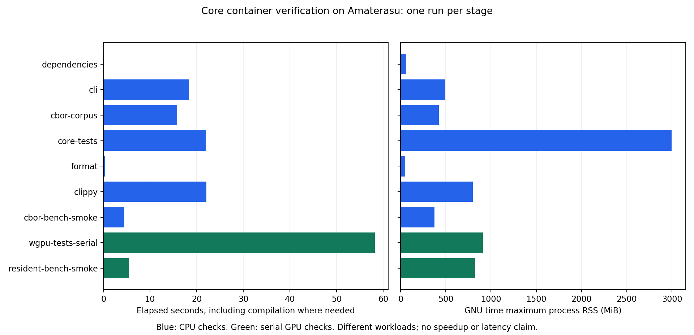

# Core Docker-ellenőrzés Amaterasun

Készült: 2026-09-05 14:16 CEST. A felhasználó a Core dockeresítését kérte
elsőként; utána engedélyezte a dependency/CI, böngészős modellfrissítés és
consumer-kísérlet folytatását, az utóbbihoz Amaterasut is.

## Ellenőrzött eredmény

A Core SDK-képe tiszta Linux Git-klónból felépült Amaterasun. Üres Linux
build-kötetről, hálózat nélkül teljesítette a Core ellenőrzéseit. Ugyanezen
képen a WGPU soros tesztjei valódi RTX 2070 SUPER Vulkan adapterrel futottak.

| Ellenőrzés | Eredmény | Parancs ideje |
| --- | --- | ---: |
| Meglévő Core CLI, minimális fixture | PASS | 18,39 s |
| Nyilvános CBOR facade, teljes lowerable korpusz | 1 pass, 0 fail; az oracle 102 programot követel | 15,79 s |
| Core release unit/integration/doctest | **357 pass, 0 fail, 7 ignored** | 21,94 s |
| Workspace rustfmt | PASS | 0,33 s |
| Workspace/all-targets Clippy, `-D warnings` | PASS | 22,07 s |
| CBOR Criterion `--test` | 6 sikeres encode/decode cella | 4,52 s |
| WGPU release, `--test-threads=1` | **170 pass, 0 fail, 0 ignored**, nincs `SKIPPED` | 58,17 s |
| Rezidens SpMM Criterion `--test` | **48 sikeres cella**, valódi discrete GPU | 5,52 s |
| Provider SYMBOLS és token-duplikáció | PASS; 402 clone / 7769 sor, baseline 403 / 7800 | külön kapuk |

A külön CBOR-próba ismételten futtat egy meglévő tesztet; nem számít további
egyedi tesztnek. A 357 Core-teszt bontása: 134 unit + 216 integration + 7 doctest.
A WGPU összegében a CPU-t futtató unit/doctest esetek is szerepelnek; a GPU-t
igénylő utak végrehajtását a kihagyásmentes log és az adapterazonosítás bizonyítja.

**Nyitott korlát:** a WGPU alapértelmezett párhuzamos futása a session tesztcsoportnál
elakadt. A soros konfiguráció ellenőrzött; a párhuzamos elakadás gyökérokát ez a
munka nem oldotta meg. Nincs általános párhuzamos GPU-readiness állítás.

## Forrás, tulajdonjog és képazonosság

- Worktree: `D:/hnnwork/amaterasu/core`, branch: `build/core-amaterasu-2026-09-05`.
- Kiinduló auditcommit: `69a5ec947b610a9ccc683d3f8d761d19d30c5b47`.
- A végső kép forráscommitja: **`c935909ec97bcb01e9dafd52d64227ee9df81e4b`**.
- Amaterasu tiszta klón: `/home/kyberszittya/hymeko-core-amaterasu-20260905/clean/core`.
- Helyi Amaterasu image tag: `hymeko-core:c935909ec97bcb01e9dafd52d64227ee9df81e4b`.
- Image ID: `sha256:a26c1d9cec52094054fa31cbb482fedb0a57562149b3a9b6cfdb25e1f79e1d5c`.
- BuildKit manifest digest: `sha256:8a465116b9cc9c525935159b425bc1d81c680a8848f10ac57cde49905927ab26`.
- Cargo.lock SHA256, a Gitben és a végső képben egyaránt:
  `8dfe43c52f9d8a42217c35a2bbf6e9843e05f4b4ea938d9286e827cffbb9dcc7`.
- Parser Git-revízió: `e28a205147c48273980e63aa3338ca286974a6ed`, a lock szerint.
- `data/` Git-tree: `70de1b226b01744c99672d7e87dec04ad2320431`.
- A minimális bemenet SHA256-a:
  `b58d272c500c1484c424fb5082b4add263462e33303101ccd91e1b36e3dc636e`.

A forrásátadás Git bundle-lel történt, nem publikálással. Bundle SHA256:
`e510f88f92724b3dc7cf5a31bbe50a299b34abb66c14201d57e54e024caf242b`.
Az image revision labelje egyezik a klón HEAD-jével. A build előtt és az
ellenőrzések után a távoli klón tiszta; a tesztek a képen belüli forrásmásolatra
írnak. A későbbi jelentéscommit dokumentációt és bizonyítékokat rögzít.

**CORE.YAML által védett módosítások: üres lista.** A `hymeko_core/`,
`hymeko_wgpu/`, `data/`, Cargo.toml és Cargo.lock Git-tartalma pontosan egyezik
a kiinduló auditcommittal. Nem változott API, IR, hash, wire schema vagy fixture.
Core tulajdona a fordítás és a kanonikus modell; a meglévő CLI és CBOR facade
szolgáltatja a próbákat. A közös contract-tooling a külön `hymeko/hymeko` provideré.

## Változások és reprodukció

| Infrastruktúra | Változás a kiinduló commithoz |
| --- | --- |
| `.dockerignore` | +20 sor, engedélyezett build-inputok |
| `.gitattributes` | +6 sor, evidencia-bájtok és shell LF |
| `tools/ci/Dockerfile` | +40 sor, SDK/fetch/verify rétegek |
| `tools/ci/core.sh` | +77 sor, meglévő ellenőrzések és erőforráskorlátok |
| `docs/core-container.md` | +152 sor, build/run/GPU/provenance útmutató |
| `docs/plans/2026-09-05-core-amaterasu/` | tex +99, tikz +11, mmd +8 sor és generált PDF |
| Ez a jelentés és `reports/core-amaterasu/` | új bizonyítékcsomag; teljes fájllista, méret, sorszám és SHA256 a manifestben |

A pontos parancsok a [futtatási útmutatóban](../docs/core-container.md) és a
[verziózott entrypointban](../tools/ci/core.sh) vannak. A tényleges Docker
parancsokat, limiteket és exit/OOM állapotot a konténer-inspect JSON-ok őrzik;
a build argumentumait és digestjeit az `image-final-build.json` tartalmazza.
Az útmutató GPU-blokkja hibánál leáll, és időkorlátot alkalmaz.

Rövid újrafuttatás Amaterasun, már meglévő képpel és a feladat saját kötetével:

```sh
docker run --rm --init --network=none --memory=16g --memory-swap=16g --cpus=6 \
  --mount type=volume,src=hymeko-core-clean-target-20260905,dst=/workspace/core/target \
  hymeko-core:c935909ec97bcb01e9dafd52d64227ee9df81e4b all
```

Ez cache-t újrahasználó ellenőrzés. A jelentésben szereplő 83,35 másodperces
végső CPU-futás új, ellenőrzötten üres `hymeko-core-clean-target-20260905`
köteten indult. Laptop target/vendor könyvtár nem került a képbe.

A base image Rust 1.97.1 Bookworm linux/amd64, digestje a Dockerfile-ban rögzített.
Rust/Cargo: 1.97.1, LLVM: 22.1.6. Új Rust dependency nincs. Csak a konténerbe
került rustfmt, Clippy és az apt-csomagok: `time` 1.9-0.2,
`libvulkan1` 1.3.239.0-1, `libegl1` 1.6.0-1 és tranzitív natív könyvtáraik.
A buildnapló őrzi a telepítést. A hostra nem települt csomag és nem változott driver.

A privát parser letöltése `cargo fetch --locked` alatt, rövid életű SSH-agent
továbbítással, BuildKit SSH mounttal és a már megbízhatónak ismert hostkulccsal
történt. A kulcs nem került image-be, build argumentumba vagy távoli fájlba.
Minden végső ellenőrzés `--locked --offline` és Docker `--network=none` mellett futott.
Az SDK private dependency forrásokat tartalmaz; a kép helyben maradt Amaterasun.
A base digest rögzített, az apt-tároló nem snapshot: a tesztelt kép azonosított,
a jövőbeli build bájtról bájtra azonosságát nem állítjuk.

## Diagnosztikai kontrollok

1. **EGL-hiány:** a korábbi képen `nvidia-smi` látta a GPU-t, de a Vulkan ICD
   nem tudott instance-t létrehozni. A WGPU tesztek `SKIPPED` mellett nullával
   zártak. Ez rendelkezésreállási kudarc, nem GPU-siker.
   Azonos képen és benchmarkbinárison egy eldobható konténerbe csak `libegl1`
   és függőségei települtek; két kiválasztott SpMM cella már az NVIDIA Vulkan
   adapteren teljesült. Ezután került a könyvtár a Dockerfile-ba.
2. **Párhuzamos session-elakadás:** a javított képen az első 112 WGPU-teszt
   teljesült, majd a kilenctesztes session csoport több mint két percig nem
   haladt, közel egy CPU-magot foglalt. A saját konténert leállítottam;
   logja és folyamatállapota megmaradt. Ugyanaz a kilenc teszt sorosan 2,26 s
   alatt teljesült. A teljes soros csomag és a végső tiszta kép ellenőrzése is
   sikeres. Ez futtatási beállítás, nem a párhuzamos hiba kijavítása.
3. **Windows archive-sorvégek:** az első Core/provider archívumban CRLF volt.
   Az első Core lock hash-e `e1ab2c2be3b2f645f16931b8eb7a52c8b2ca54751857f512c4edabff1b0003d2`;
   LF-re normalizálva pontosan egyezik a Git blobbal. A provider shebangje emiatt
   nem indult. A végső Core-kép tiszta Linux-klónból épült. A provider végső
   archívuma `git -c core.autocrlf=false archive` használatával készült; mind a
   15 inputfájl bájtról bájtra egyezik a provider Git-revíziójával. Provider-fix
   nem kellett. Az eredeti sikertelen logot is megtartottam.
4. **Runner hibakezelés:** shell szintaxis, LICENSE, izolált SSH/config és
   argumentumellenőrzések sikeresek. Ismeretlen/extra argumentum és engedélyezett
   swap 2-es kilépést ad. A végső képen egy 42-vel kilépő Cargo-kontrollt a
   `smoke` stage 42-ként adott tovább, nem jelentett sikert.

A provider végső képe `hymeko-core-contract:515f285-lf`, forrása
`515f285886495fdcb5866f2ddafe1889a99757ab`, image ID:
`sha256:917a1626a3caa68f59b40a1d54c86b0cfd6c431009cf2a411cd10ccbc4825ec9`.
A provider változatlan belépőpontjával futott a `symbols` és `duplication` kapu,
read-only Linux Git-klónon, a klón tulajdonosának UID/GID-jével, hálózat nélkül.
`jscpd`-delta nem futott: a Core jelenlegi baseline-ja a token-detektorhoz
tartozik. Új baseline-t ez a feladat nem írt.

## Erőforrások és értelmezés

Amaterasu: AMD Ryzen 7 3700X, 8 mag / 16 szál, 33 589 596 160 bájt RAM;
Ubuntu 24.04.4, Linux 7.0.0-28-generic, Docker 29.4.0, buildx 0.33.0, cgroup v2.
GPU: RTX 2070 SUPER, 8 GiB, NVIDIA 595.91.07. A CUDA-verzió az `nvidia-smi`
driver-képességadata; CUDA implementáció nem futott ebben a feladatban.

| Konténer | Teljes falióra | Cgroup memória-csúcs | Legnagyobb stage process RSS |
| --- | ---: | ---: | ---: |
| Végső Core, üres target | 83,35 s | 3 708 485 632 B = 3,45 GiB | 3 068 784 KiB |
| Végső WGPU, soros | 63,85 s | 2 054 275 072 B = 1,91 GiB | 931 728 KiB |

Mindkettő: 6 CPU, 16 GiB memory, memory+swap ugyancsak 16 GiB, hálózat nélkül,
exit 0 és OOMKilled=false. A dedikált BuildKit builder is 16 GiB / swap nélküli
limitet és 6 CPU kvótát kapott. A cgroup-csúcs a teljes konténeré, page cache-t
is tartalmaz; nem stage-csúcs és nem process RSS. A kezdeti logok rövidebb
`cgroup_peak_bytes` mezője ugyanezt a kumulatív értéket jelentette.

Az első előzetes CPU-futás 82,24 s volt. Ez alapján korrigáltam a terv kezdeti,
túl konzervatív 10–25 perces cold-compile becslését 1–2 percre. A futások
ellenőrzési költségek, különböző inputállapotokkal; nincs gyorsulás-, variancia-,
p95/p99-, consumer-throughput- vagy amortizációs állítás. A GPU-n a host más
folyamatai is jelen voltak. Véletlen campaign-seed nincs, a meglévő determinisztikus
fixture-ök futottak. A CBOR scale-ek 1/45/409 deklarációs korpuszbemenetek.



A [JSON összegzés](core-amaterasu/summary.json) adatai a nyers logokból és
inspectekből származnak. Az ábra forrása `core-amaterasu/plot_resources.py`;
Amaterasun Python 3 / Matplotlib 3.6.3-mal futott, PNG és SVG kimenettel.
Ez nem térbeli/szimulációs kísérlet, ezért viselkedési animáció nem készült.

A hét kihagyott Core-teszt: `probe_all_ten` (taxonómiai dump),
`canonical_cbor_memory_decode`, `canonical_cbor_memory_materialize_only`,
`canonical_cbor_memory_read_baseline`, `write_canonical_cbor_memory_fixture`
(mérési/diagnosztikai cellák vagy fixture-generátor), `bench_lowering_corpus`
és `bench_incidence_operator_vs_clique` (külön mérési célok). Nem használtam
általános `--ignored` futtatást, és nem építettem előre az `ir_depth_probe`-ot.

## Nyitott munka és visszaállítás

1. **Dependency/CI:** a most ellenőrzött Core entrypoint bekötése a tényleges
   runnerbe és hitelesítésbe; több repón át lockolt crate-azonosságok ellenőrzése.
   Ide tartozik a provider/jscpd baseline és a párhuzamos GPU-session hiba célzott
   kivizsgálása. Az utóbbit a soros kapu nem tekinti megoldottnak.
2. **Böngészős integráció:** valódi modellváltozás bizonyítása az ingressen,
   állapotátmenettel és felületi ellenőrzéssel.
3. **Consumer-kísérlet Amaterasun:** rögzített consumer SHA, bemenet, correctness
   oracle, elkülönített cold/warm és compute/transfer időhatárok. Ezt a jelenlegi
   SDK és GPU-próba előkészíti, de még nem teljesíti.

Az `arrow-schema`/`ipc` feature campaign, fuzz/security campaign, csomagpublikálás,
release és a három fenti integrációs lépés még nem készült el. Nincs push,
merge vagy release/tag. A feladat saját builderét, képeit és két target-kötetét
megtartottam a következő consumer munkához. A korábban futó hymeko-circuit,
experiments-next, caddy, gitea, gitea-db és ARM builder szolgáltatások tovább futnak.

Rollback: kizárólag a feladat tematikus commitjainak visszavonása és a név szerint
azonosított saját Docker-erőforrások eltávolítása, tulajdonellenőrzés után.
Globális prune, host-konfiguráció módosítása vagy más szolgáltatás leállítása
nem része a visszaállításnak. A korábbi audit jelentése és evidenciája változatlan.

## Előzetes Discovery ledger

Az alábbi ledger 13:23 CEST-kor, az implementáció előtt készült; a terv PDF-je
13:24-kor már lefordult. A 14:03-as mért becslésfrissítés után újra lefordult.

```text
DISCOVERY LEDGER — Core Docker Amaterasun
  find:    a Core-ban nincs Dockerfile/.dockerignore; a provider tools/ci/Dockerfile és entrypoint.sh meglévő
  grep:    meglévő Core CLI, CBOR roundtrip/fault tesztek és cbor_bench; egyetlen lockolt parser Git-függőség
  symbols: ModuleStore::compile, encode_compiled és decode a meglévő SYMBOLS.md-ben
  read:    AGENTS.md, CORE.YAML, tools.yaml, Cargo manifestek/lock, CI workflow, provider Dockerfile/entrypoint, Core CLI és CBOR bench
  verdict: NEW .dockerignore, tools/ci/{Dockerfile,core.sh}, docs/core-container.md, docs/plans/2026-09-05-core-amaterasu/{plan.tex,plan.pdf,plan.tikz,plan.mmd}, reports/2026-09-05-core-amaterasu.md és reports/core-amaterasu/*.
           A provider konténere a közös contract-tooling tulajdonosa, nem tartalmaz Rust buildkörnyezetet; nem másoljuk át. A korábbi audit tervét és nyers méréseit történeti bizonyítékként őrizzük meg.
```

A végső bizonyítékok és hozzáadott/módosított fájlok teljes jegyzéke:
[artifact-manifest.json](core-amaterasu/artifact-manifest.json).
A manifest saját magát nem hash-eli. A korábbi `platform-audit/summarize.py`
Criterion-eloszlásokat összegez; az új ábra más, konténer-stage sémát olvas,
ezért a történeti kampánykód változatlan maradt.
