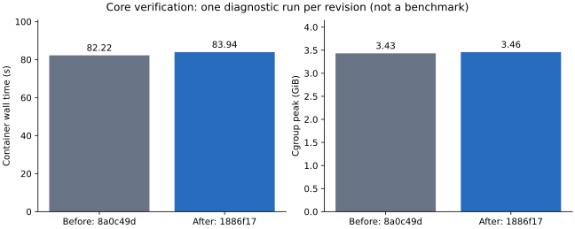

# Core és fogyasztók függőségfrissítése

Created-at: 2026-09-05 20:11 +02:00. Updated-at: 2026-09-06 00:31 +02:00.
Állapot: **a jóváhagyott Core Parser-frissítés elkészült és tiszta Docker-képben
ellenőrzött és feature branchen publikált**. A Graph, Transformation, Hotaru,
Network és LSP frissítése ellenőrzött és publikált. A helyi Simulator snapshot
ingress- és WASM-kapuja sikeres. Az egységes revíziókészlet helyi audit-tagekkel
rögzített; a tényleges böngészős kísérlet és külön feature-ágak integrációja későbbi scope.
Aktív Core: `D:/hnnwork/distributed/core`,
`audit/core-distributed-semantics-2026-09-05`, alap `7186b55`. A provider frissítése
elkészült `d02aa614`-re; [külön jelentés](2026-09-05-contract-provider-refresh.md).

## Hátramaradt ágak auditja — 2026-09-06

A felhasználó „nézzük a hátramaradt ágakat” kérése alapján a két kizárt feature-ág
vizsgálata elkészült. **Graph: feltételesen integrálható, szemantikai feloldással.
Core SemanticModelDigestV2: jelen állapotában nem megfelelő teljes
modellazonosítónak; négy követelményteszt reprodukált hibát.** Ez az audit nem
integráció, nem új release vagy fogyasztói frissítés. A korábbi audit-tagek változatlanok.

### Friss ágállapot és az integráció terjedelme

Core, Graph és a shared-contract provider fetchje 00:15-kor sikeres volt.
A vizsgált Core és Graph munkafa induláskor tiszta, befejezetlen Git-művelet nélkül.
Az aktív implementációs checkoutok változatlanok; a Core-ban csak e jelentés,
a meglévő tervnégyes és a diagnosztikai bizonyítékok változnak.

| Repo | Audit HEAD | Bejövő ág és HEAD | Saját / bejövő commit | Merge-base |
|---|---|---|---:|---|
| Core | `89d221fb8a0545fc3db2098548f1c81065a3e64e` | `fix/semantic-model-digest-v2`, `112a2543264e302839fd7f2cf04858fd098c8f5c` | 16 / 5 | `0a34a976457fdc775abe180295ab0ac70598a89f` |
| Graph | `4a59c238af4a4af86e43fa905b96606284b34d10` | `feat/codex-p34-independent-audit`, `83774b8bdb170ace87506a02c0655397f806a0b8` | 4 / 49 | `b234c4871807dc255854cc4b50d1458547dca7d3` |

`git merge-tree --write-tree --name-only HEAD <incoming>` nem módosított indexet,
munkafát vagy branchet. Core: exit 0, eredményfa
`008a96b97495e698a8651800a39a01764cb872e4`, 13 változó fájl az audit HEAD-hez képest.
Graph: exit 1, konfliktusjelölőket tartalmazó diagnosztikai fa
`e9eda5a4d52ec652975ca29f5380d6180d9acd82`; ez nem használható integrált forrásként.

A Core öt bejövő commitja három külön felelősség:

- `93b1f11`: hordozható CBOR ID-sentinel (`common/ids.rs`, `ids_impl.rs`, saját report).
- `044a7c3`, `70d0de2`, `9c2f87e`: geometriai hajtások, Aibo kontaktok és sztereó
  kamerák; `data/robotics/meta_kinematics.hymeko`, `robots/humanoid.hymeko`,
  `robots/quadruped.hymeko` változik.
- `112a254`: a hétfájlos digest-változás, `CORE.YAML`,
  `hymeko_core/src/ir/{hash_pass.rs,mod.rs,semantic_digest.rs}`,
  `hymeko_core/src/module_store/module_store.rs`,
  `hymeko_core/tests/unified_ir/verification/{mod.rs,semantic_digest.rs}`.

A teljes ág merge-je ezért nem egyszerű digest-frissítés. A célzott digest-átvétel
nem igényli a portable-ID vagy robotfixture commitok átvételét. Az auditág újabb
Parser-lockját és admission-javításait meg kell tartani.

### Core: reprodukált azonossági hibák

Az alábbi forrássorok a bejövő `112a254` Git-fára vonatkoznak. A próbák az ág
meglévő tesztmodulját és fixture-builderét használják; termékimplementációt nem
helyettesítenek. [A négy követelményteszt](dependency-refresh/remaining-branches-probes.rs.txt),
[végső nyers napló](dependency-refresh/remaining-branches-coverage.log).

| Súlyosság | Megfigyelés | Kódhely és következmény |
|---|---|---|
| P1 | Eltérő, CBOR-validált incidenciacél azonos V2-t kap | `semantic_digest.rs:158–169`: az edge csak ArcId-t ír; az ArcRec tartalma csak külön arc-deklaráción át kerül be. A külön deklaráció nélküli rekordot encode és decode is elfogadta; a V1 különbözött. |
| P1 | 64 listába csomagolt `Num(1)` és `Num(2)` azonos V2-t kap | `:287–289`: mindkét különböző levél `TRUNC` lesz. Ez azonos hash-bemenet, nem kriptográfiai ütközés. Az API nem deklarál ezt kizáró bemeneti korlátot. |
| P2 | Ugyanaz a modell deklaráció-átszámozással eltérő V2-t kap | `:183–189`: DeclId-sorrendben foldol. Az azonos név-/hierarchia-/incidenciaszerkezetet a V1-egyezés külön ellenőrzi. |
| P2 | Ugyanaz a modell az ArcRec-tárolás átrendezésével eltérő V2-t kap | `:161`: a globális nyers ArcId bekerül az edge hash-ébe. A kontroll megőrzi a deklarációkat és a per-edge incidenciasorrendet, V1-egyezéssel. |

Az eredeti construction-order teszt csak az interner beszúrási sorrendjét cseréli;
nem fedi a két tényleges tárolási permutációt. További, **nem futtatott statikus
szerződéshézag** a „total on malformed input” ígéret: `:142` ellenőrizetlen
interner-feloldást, `:151` közvetlen rekordindexelést használ. Ezt a négy
reprodukált hibától elkülönítve kell kezelni.

### A corpus-hiba kontrollált magyarázata

A bejövő commitüzenet a változatlan corpus-golden hibáját `7019940` hash-refaktorának
tulajdonítja. A `canonical_hash.rs` Git-blobja viszont a merge-base, a bejövő ág és
az audit HEAD alatt egyaránt `ba39191206a2eed5bdf9f659bce3f35479182efc`.
Azonos `mod-f87f1ab25fa3d2aa` tesztbinárissal és azonos Parser `e28a2051`-gyel:

| Fixture-fa | Eredmény |
|---|---|
| Bejövő `112a254` | FAIL: tényleges `8938b37b221ba015f1a52f318f8b9d9ac9aab65777ee07026916bf2b1d13dd12`, elvárt `f9ab7da8…` |
| Audit `1886f17` | PASS az eredeti, változatlan `f9ab7da8…` golden ellen |

Csak a `data` fát cseréltük a diagnosztikai konténerben; a kód, a lock és a golden
változatlan maradt. A három módosult fixture hash-e szerepel az
[első naplóban](dependency-refresh/remaining-branches.log). Ez a kontroll a
fixture-eltérést igazolja e bukás elegendő okaként. A hibaüzenetből nem következik
hash-algoritmus-regresszió vagy visszaállítási szükséglet. A robotfixture-k későbbi
átvételekor a corpus-goldent dokumentált fixture-migrációként kell kezelni.

### Graph: a konkrét feloldás

A négy szöveges konfliktus: `benchmarks/Cargo.lock`,
`hymeko_graph/src/direct_ir/informed.rs`, `berge_enum.rs`,
`hymeko_graph/tests/direct_ir_optional.rs`. Emellett a diagnosztikai merge-fa
**konfliktus nélkül visszaállítaná a benchmark Parser-lockot `284c490d`-ről
`e28a2051`-re**. A tiszta szöveges feloldás önmagában nem elég.

| Felület | Megőrzendő / átveendő szerződés |
|---|---|
| Directed incidence | Az auditág pontos `incident_arcs.zip(incident_slots)` iterációja; az incoming hosszellenőrzése hozzáadható. |
| A* arcmunka | Marad `TransitionPolicy::entry_independent()` és `arc_entry_g`: csak entry-independent cost és policy mellett, nem kisebb új belépési `g` esetén hagyható ki az arc. |
| Workspace | `arc_entry_g` generációval együtt nő és érvényesül; a P34 kompatibilis stats-reset és `heuristic_evals` számlálása átvehető. |
| Berge budget | Marad az endpoint-validálás utáni nulla result-budget és az auditág helyi Depth/frontier állapotgépe; Results/Expansions globális elsőbbséggel. |
| P34 goal-pruning | Átvehető: a már elért goalból egy egyszerű út nem találhat új goalba visszatérő egyszerű utat. |
| P34 cycle-dedup | Átvehető a node+arc alternáló cikluskulcs; a node-only kulcs különböző párhuzamos arcokat összevon. |
| Lockok | Root és benchmark workspace egyaránt a most ellenőrzött Core `ac1131b` és Parser `284c490d` azonosságát tartsa, amíg új Core nincs tesztelve. |

A P34 `reopened` számlálója (`informed.rs:645`) nem hiteles ellenőrzés:
`entry.g_at_push < ws.g(node)` nem lehet igaz, ha a query során a tárolt `g` csak
csökken. A nulla érték így nem bizonyítja a konzisztens A* helyességét. A settled
csúcs későbbi javulási kísérletét a relaxáció helyén kell megfigyelni; ez önmagában
még nem tényleges újranyitás. A számláló nevét/szerződését ehhez kell egyeztetni.

A goal-pruning miatt a meglévő DEEP_THEN_SHORT táblában a
`(max_results=100,max_expansions=4)` sor külön path/cycle elvárást igényel.
**Statikus előrejelzés, még nem futtatott integrált eredmény:** path 2 + Depth,
cycle 1 + Expansions. A régi frontier-regresszió nem törölhető.

A P34 hasznos új felülete a kölcsönzött `MatroidRef`, a közös
`GraphicMatroidWorkspace`, a rank-2 és implicit Levi műveletek; tulajdonosuk Graph,
nincs új kanonikus IR. A snapshot/provenance-javító `b8e5afe` megőrzendő a hozzá
tartozó korábban bukó kontrollokkal. A szeptember 3-i általános COMPLETE állítást
az independent-audit report cáfolta. A későbbi szeptember 4-i evidence több mérési
hiányt lezárt; a reprezentációk korrekt összehasonlításának alapja a későbbi
`reports/performance-evidence/2026-09-04-dijkstra-comparability/report.md`.
A batch-skálázás független lekérdezésekre vonatkozik, nem egyetlen queryre;
az implicit Levi három eredeti workloadon nem jobb a canonical count-only útnál.
Ezek korábbi revíziók eredményei, nem a majdani integráció friss mérései.

Három történeti SHA256-manifest 34 tételének ellenőrzése: 1 Git-blob byteazonos,
33 kizárólag LF→CRLF konverzió után egyezik; megmagyarázatlan tartalomeltérés nincs.
A történeti hash-domén Windows-checkout bájtjaihoz kötött. Az eredeti mérések
átírása helyett az integráció külön provenance-jegyzéke rögzítse a Git-blob hasht
és a történeti CRLF-domént. Új benchmark ehhez nem szükséges.

### Végrehajtás, következő kapuk és határok

Amaterasu: meglévő SDK `hymeko-core:1886f17a42d7a3430e4044129f81955615efd583`,
Rust/Cargo 1.97.1, release, offline, 6 CPU, 16 GiB, hozzáadott swap nélkül.
Az incoming forrás Git archive-ból a konténerek ideiglenes fájlrendszerébe került;
csak a tesztmodult bővítettük. A forrás-checkout tiszta maradt. A meglévő target/cache
újrahasznosított; az időadatok tesztfutási költségek, nem benchmarkeredmények.

| Ellenőrzés | Eredmény | Wall | Peak RSS / cgroup peak |
|---|---|---:|---:|
| Első digest-kontroll | 18 PASS, 3 FAIL, 0 ignored | 9,70 s | 436 628 KiB / 457 224 192 B |
| Incoming corpus | 0 PASS, 1 FAIL | 0,17 s | 65 348 KiB / az első konténerben |
| Ugyanaz audit fixture-rel | 1 PASS, 0 FAIL | 0,17 s | 65 736 KiB / az első konténerben |
| Kiterjesztett digest-kontroll | 18 PASS, 4 FAIL, 0 ignored | 4,76 s | 440 524 KiB / 369 963 008 B |

A Cargo FAIL kódja 101; a diagnosztikai wrapper a várt negatív/pozitív kódokat
ellenőrzi, ezért exit 0-val zárult. Ez nem zöld termékteszt. Mindkét konténer
OOM=false és leállt. [Összesítő, forrásazonosságok, fájllista és hash-ek](dependency-refresh/remaining-branches.json).
A korábbi consumer-execution-manifest továbbra is a `89d221f` commitban tárolt
történeti bájtokat igazolja, nem e kiegészítés módosított tervét.

Következő végrehajtási sorrend:

1. **Core digest-szerződés és javítás.** Csak a digest-commit scope-ját vigyük
   tovább: teljes incidencialefedés, információvesztés nélküli értékkódolás,
   tárolási azonosítóktól független modellazonosság. A malformed input
   elfogadási/hibajelzési szerződését és a tényleges downstream call site-okat
   előbb pontosítani kell. V1 bytes, CBOR schema és `Ir::decl_hash` tartalma ne
   változzon ettől. Érintett fájlok: a fenti hét digest-fájl, továbbá generált
   `SYMBOLS.md`; nincs szükség új függőségre. A négy kontroll után a meglévő
   18 teszt, teljes Core-kapu, CBOR corpus, kilenc admission-regresszió, fmt és
   Clippy szükséges. A mostani lelet nem kész javítási patch vagy jóváhagyás.
2. **Graph integráció külön tematikus commitokkal.** A fenti négy konfliktus
   kézi szemantikai feloldása és lock-ellenőrzés után `informed_search_vv`,
   `direct_ir_optional`, `direct_ir_coverage`, `informed_berge_evidence`, valamint
   a matroid/provenance tesztek. A három platformregresszió és a párhuzamosarc-
   ciklusazonosság kötelező; P32 `instrumented_search_matches_oracle` és
   `counters_reset_under_reuse` célzottan. Utána workspace release/locked/offline,
   a nyolc governance-kapu és a külön benchmark workspace fordítása. Új
   teljesítményállítás csak megfelelően párosított mérésből következhet.
3. **Portable-ID és robotmodellek külön migrációban.** Előbb natív↔WASM sentinel
   és malformed ID kontrollok, valós böngészős consumer ellenőrzés; utána a
   robotmodellek Transformation/Simulator validálása és dokumentált corpus-
   frissítése. Csak a tesztelt szolgáltatói revíziók után frissüljenek a
   fogyasztók; új tag ne mozgassa a már létező audit-taget.

A [Core CORE.YAML approval része](../CORE.YAML) szerint a token csak saját
slugjára érvényes; a Parser- és admission-token nem terjed ki ezekre a
forrás-/wire-változásokra. A bejövő commit másik munkamenetből származó approval-
megjegyzése nem általános engedély új javításra. A Graph CORE.YAML szintén védi
az algoritmusokat. E read-only audit és tesztbizonyíték elkészítéséhez nem
szükséges új engedély; védett implementáció előtt konkrét javítási terv és az
alkalmazható jóváhagyás szükséges. Main merge/push, dependency-frissítés és
tagmódosítás nem történt.

A Lean admission-modell 19 tétele változatlan. A specifikáció kifejezetten opaque
identity/payload címkékkel dolgozik, és nem bizonyít digest-bindinget. A V2
bevezetése ezért önmagában nem frissíti vagy teljesíti ezt a formális kötelezettséget.
V1, V2 és az ir_stream tranzakcióazonosság külön szerződés marad.

Rollback: most csak a dokumentációs auditcommit visszavonása szükséges. Későbbi
integrációnál külön digest-, Graph-, portable-ID- és fixture-commit visszavonható;
a fogyasztói pinfrissítések fordított függőségi sorrendben állíthatók vissza.
Az ellenőrzött `audit/core-consumers-2026-09-05` készlet és a negatív bizonyítékok
megmaradnak. E körben nem futott teljes új Core/Graph suite, benchmarkkampány,
WASM runtime, browser vagy új Lean-bizonyítás; ilyen eredményt nem állítunk.

## A legkisebb védett változás

Egy fájl: `Cargo.lock`, a Parser Git-source commitja:

- régi: `e28a205147c48273980e63aa3338ca286974a6ed`;
- friss `origin/master`: `284c490d68232973a006bcba974279fed6f89ce8`.

[Alkalmazható patch](dependency-refresh/core-parser.patch),
[előzetes terv](../docs/plans/2026-09-05-dependency-refresh/plan.pdf).
A Parser két commitjának diffje kizárólag saját `Cargo.lock` hozzáadása, 987 sor.
A Parser forrása és manifestje byteazonos; a consumer továbbra is saját lockból
old fel. A Core root `Cargo.toml` meglévő `branch = "master"` deklarációja megfelelő,
és az URL is megmarad. Nincs grammar-, API-, IR-, wire- vagy fixture-változás.

Az eredeti feladat „Védett Core-határ” része kifejezetten előírja az alkalmazható
literal tokent a dependency-felületre; a [Core manifest](../CORE.YAML) `approval`
szakasza és Parser-bejegyzése ugyanezt rögzíti. Az admission-javítás korábbi
engedélye erre nem terjedt ki. A felhasználó a következő külön tokent megadta;
a jóváhagyott végrehajtás 20:45-kor folytatódott:

`APPROVED-CORE-EDIT: core-parser-latest-revision`

Cargo pontos `--precise` frissítése után az egyetlen várt sorváltozást ellenőriztem,
majd az Amaterasu meglévő tiszta Core SDK `all` ellenőrzését lefuttattam.
A teljes Core-suite, kilenc admission-regresszió, CBOR corpus, fmt, Clippy
és benchmark smoke sikeres; egy Parser-source szerepel a feloldott gráfban.
16 GiB, hozzáadott swap nélkül, 6 CPU. A Lean-forrás változatlan, a meglévő 19 tétel
bizonyítéka továbbra is használható; nem futott újabb, indokolatlan Lean-mérés.
Rollback: csak az új dependency-commit
visszavonása az előző Cargo.lock revízióra. A patch előzetes `git apply --check`
ellenőrzése nem helyettesíti a majdani buildet és teszteket.

Az előzetes `git apply --check`: PASS volt, a Core lockfile akkor változatlan. A terv PDF-je
sikeresen lefordult. [Ellenőrzési adatok](dependency-refresh/verification.json),
[teljes előkészítő fájllista és sorváltozások](dependency-refresh/artifact-manifest.json).
A manifest a `7186b55` alaphoz képest tartalmazza e jóváhagyási csomagot, önmaga
kivételével, a `0c4e40a` történeti revízióban. Az előzetes `verification.json`
ennek a jóváhagyás előtti állapotnak a bizonyítéka, nem a mostani státusz.

## Jóváhagyott végrehajtás és mérési bizonyíték

Implementáció: **`1886f17a42d7a3430e4044129f81955615efd583`**. A token a
commit footerében és az implementáció előtt frissített, lefordított tervben szerepel.
A Core `Cargo.lock` pontosan a tervezett egyetlen Parser-source sort változtatja.
A Rust források, fixture-ek és az összes registry-függőség megmaradtak.

Az első `cargo update -p parser --precise 284c490d68232973a006bcba974279fed6f89ce8`
a `winapi-util 0.1.11` `windows-sys` élét is újraválasztotta 0.61.2-ről 0.48.0-ra.
A crate manifestje mindkettőt megengedi (`>=0.48.0, <=0.61.*`). A nem kért
resolver-változást visszaállítottam az eredeti 0.61.2-re; a `--locked --offline`
fa és az új Linux-kép feloldása így is sikeres. [Kezdeti delta](dependency-refresh/cargo-update-initial.patch),
[Cargo-log](dependency-refresh/cargo-update.log),
[pontos változási ellenőrzés](dependency-refresh/implementation-check.json).

Az új kép az előző, tiszta Amaterasu checkoutot használta újra, ellenőrzött
`8a0c49d` alapról Git bundle-lel fast-forwardolva. Bundle SHA256:
`43eb5ca28149989ce3a3676d7ca13b2931a22469423dd3771dc2497204b6a380`.
Az előző kép és mérési logok megmaradtak. A build ugyanazt a korlátozott buildert
és csak a build idejére forwardolt SSH-agentet használta.

Kép: `hymeko-core:1886f17a42d7a3430e4044129f81955615efd583`;
image ID: `sha256:c825ade5a9b80d45648ef5175398707cffe5b028b251015d69c39b9abc8a1308`.
Konténer: `hymeko-core-parser-20260905`, befejezett; új, kezdetben üres target volume:
`hymeko-core-parser-target-20260905`. Nincs source bind mount vagy hálózat a futásban.
Az image lockfile SHA256-ja megegyezik a Git-forrással:
`4871f04cb0c24865c17ddf4507f83136c1c70caffeac6eaf27fc94acd075056c`.

[Teljes nyers log](dependency-refresh/core-all.log),
[gépi eredmények](dependency-refresh/execution-results.json),
[konténerállapot](dependency-refresh/container-final.json),
[image metadata](dependency-refresh/image-build.json),
[feloldott csomaggráf](dependency-refresh/image-metadata.json).

| Ellenőrzés | Eredmény | Diagnosztikai idő / peak RSS |
|---|---|---|
| Teljes Core release-suite | 366 PASS / 7 ignored | 21,31 s / 3068780 KiB |
| Kilenc admission-regresszió | 9 PASS, a teljes suite részeként | nem külön mérés |
| CBOR corpus | 1 PASS, külön smoke-futás | 15,92 s / 433996 KiB |
| Workspace fmt | PASS | 0,33 s / 52484 KiB |
| Workspace/all-target Clippy | PASS, warnings denied | 22,19 s / 816020 KiB |
| CBOR encode/decode, három méret | 6 smoke-eset PASS | 4,60 s / 382204 KiB |
| Core CLI | PASS | 19,27 s / 508400 KiB |

A teljes konténer 83,941 s alatt végzett, exit 0, OOM=false. Cgroup-memóriacsúcs:
3713777664 bájt, kb. 3,46 GiB; ez page cache-t is tartalmaz, nem process RSS.
A korábbi futás 82,223 s / 3685134336 bájt volt. Az ábra egyszeri diagnosztikai
összehasonlítás, nem benchmark vagy gyorsulási állítás.



Az ignored esetek változatlanok: assembler taxonomy-dump; négy CBOR memory/fixture
diagnosztika; corpus-lowering és incidence-vs-clique benchmark. Pontos neveik a
nyers logban szerepelnek. WGPU hardveres teszt, optional IPC/Arrow és fogyasztói
throughput-mérés nem része ennek a forrásazonos Parser-frissítésnek.

Reprodukció: a kép `all` belépési pontja a [Core container útmutató](../docs/core-container.md)
szerint, új üres target volume-mal. Az eredeti Rust 1.97.1 Bookworm SDK, hat CPU
és 16 GiB/no-swap limit megmaradt. A metadata egyetlen Core, WGPU és Parser
azonosságot igazol; ez még nem a későbbi fogyasztói gráf ellenőrzése.

[Végrehajtási fájlmanifest](dependency-refresh/execution-manifest.json): a
`0c4e40a` jóváhagyás előtti alaphoz mért teljes fájllista, sorváltozás és SHA256,
önmaga kivételével, az `ac1131b` revízió bájtjaira rögzítve. Utóellenőrzéskor
a `docs/core-container.md` bejegyzését javítani kellett: a helyi, kevert CRLF/LF
sorvégű fájl hashét tartalmazta a commitolt LF blob helyett. Az ellenőrzés
igazolta a kizárólagos sorvég-normalizálást. Mind a 23 bejegyzést a commitolt
blobokra ellenőriztem; [ellenőrzési jegyzék](dependency-refresh/manifest-verification.json).
A korábbi előkészítő manifest történeti állapotát megőriztem.

## Végrehajtott fogyasztói lépések

`FINAL_CORE = ac1131b5490734b855021f6076753417e1337cd6`; kódja és lockja
byteazonos a tiszta SDK-képben ellenőrzött `1886f17` implementációval.
A Core feature branch publikációját a [távoli SHA-ellenőrzés](dependency-refresh/core-publication.json)
igazolja. Az eredeti feladat 11. fázisa engedélyezte a feature push-t a branch,
commitlista, teszteredmény és remote előzetes bemutatásával; ez megtörtént.

| Fogyasztó | Tesztelt kódrevízió | Eredmény | Publikált feature HEAD |
|---|---|---|---|
| Graph | `ecf08d71` | 486 PASS / 6 ignored, 8 governance-check, 4 benchmark fordul | `4a59c238` |
| Hotaru | `84f317e2` | default 156 PASS; Core-feature 171 PASS; 0 ignored | `84f317e2` |
| Transformation | `24cfb594` | 470 PASS / 9 ignored; négy analitikus regresszió és valódi láncmodell | `0dd72e3f` |
| Network | `669ae8d4` | 50 PASS, 0 ignored | `669ae8d4` |
| VSCode/LSP | `a06fa73a` | 111 PASS, 0 ignored | `a06fa73a` |
| Simulator snapshot | `9b155f37` | 6 ingress PASS / 1 diagnostic ignored, WASM check PASS | local-only repo |

Graph root és külön benchmark workspace: egyetlen Core `ac1131b` és Parser
`284c490d` forrásazonosság, ellenőrzött locked metadata. Cgroup-csúcs
1 641 177 088 B; teszt+fordítás 53,76 s, benchmark-fordítás 19,48 s.
[Graph publikáció](dependency-refresh/graph-publication.json).
A saját Graph repo `reports/2026-09-05-dependency-refresh.md` jelentése és
hash-manifestje a publikált feature branch része.

Hotaru: a `hymeko-ir` feature aktiválásával három régi Core-mezőhozzáférés
fordítási hibát adott. Az adapter a kanonikus `Ir::arc`, `Ir::as_node`,
`Id::raw` API-ra állt át külön `84f317e2` commitban; a Core változatlan.
A meglévő `ir_hypergraph` suite a fordított nevek, előjelek, incidencia és
containment viselkedését ellenőrzi. Az adapter újrafutása a korábbi dependency
fordítás gyorsítótárát használta: default 0,32 s, Core-feature 4,25 s,
cgroup-csúcs 306 831 360 B. Ez nem tiszta fordítási benchmark.
[Eredmények](dependency-refresh/hotaru/results.json),
[nyers végső log](dependency-refresh/hotaru/adapter-tests.log),
[kezdeti hiba](dependency-refresh/hotaru/tests.log),
[publikáció](dependency-refresh/hotaru-publication.json).

Minden fogyasztói teszt az elkészült SDK-képet használja Amaterasun,
16 GiB/no-swap/6 CPU korláttal és kikapcsolt hálózattal. A Git-függőségeket
előtte külön, szintén korlátozott konténer tölti le, ideiglenes SSH-agenttel.
A fizikai hosthatár miatti ellenőrzési checkoutokat a lefordított közös terv
indokolja; a fejlesztés a meglévő Windows munkafákban marad.

Transformation: fixture nélkül két `articulated` teszt csak 8/24 esetig jutott.
A SDK saját Core robotmintáinak `/core` útvonalon elérhetővé tétele után mind
a 18 geometriai teszt átment. Az ekkor ténylegesen aktivált `many_body` láncteszt
20/20 ismétlésben hat helyett hét módot adott; a hamis mód `1,8348688e-44 Hz`.
A fixture nélküli korai returnök és az első, hibásan fixture nélkül indított
ismétlés nem validációs bizonyítékok. A forrás változatlan eigensolverében
méréssel pontos +0 a 13D lánc karakterisztikus polinomjának konstans tagja.
A külön javítás a pontos nullgyököket választja le a meglévő iteráció előtt;
négy fixture-független regresszió mind hibázott a javítás előtti kódon.
A `24cfb594` korrekció után mind a négy regresszió, valamint a valódi láncmodell
eredeti spektrumellenőrzése sikeres. Az utolsó teljes újrafutás 470 PASS / 9
ignored, 5,32 s, cgroup-csúcs 86 106 112 B meglévő target-cache mellett.
Egy köztes read-only mount három query fájlkiíró tesztet blokkolt; a saját
checkout írható mountjával a teljes kapu sikeres, tiszta Git-státusszal.
A [Transformation publikált revíziója](dependency-refresh/transformation-publication.json)
`0dd72e3fce88fdab7adeba83ff4b73c451249d92`; a saját repó teljes jelentése,
nyers negatív/pozitív naplói és SHA256-manifestje e revízió részei.
A faktorizálás csak a kiszámított polinom pontos nulláira vonatkozik; a meglévő
sűrű eigensolver kondicionálására nem állít új garanciát.

Network és LSP ugyanazt a három Git-forrást használja: Core `ac1131b`,
Transformation `0dd72e3f`, Hotaru `84f317e2`, egyetlen Parser `284c490d` mellett.
A Network meglévő, szándékosan hibás IR-fixture-jei a Core `push_decl` és
`bind_*_decl` publikus API-jával épülnek; a negatív elvárások megmaradtak.
Network: 50 PASS, 29,07 s, cgroup-csúcs 1 508 237 312 B. LSP: 111 PASS,
31,36 s, cgroup-csúcs 1 433 698 304 B. Mindkettő üres targetből induló,
offline Docker-futás, exit 0/OOM false, tiszta source-státusz.
[Network eredmény](dependency-refresh/network/results.json),
[LSP eredmény](dependency-refresh/vscode-plugin/results.json),
[Network publikáció](dependency-refresh/network-publication.json),
[LSP publikáció](dependency-refresh/vscode-plugin-publication.json).

Simulator: a Core/WebXR munkafapathok és a Core `[patch]` eltűntek a manifestből.
Minden Core/Transformation crate a fenti azonos, publikált Git-revízióból oldódik
fel. Registry-csomag, verzió és registry dependency-él nem változott. A már
meglévő Chordex `4bf70d78` és XR `33bb7738` snapshot path-függőségei megmaradtak;
ezeknek és a Simulatornak nincs remote-ja. A helyi snapshotok azonos commitjai
Git bundle-ből kerültek az Amaterasu ellenőrzési könyvtárába.

```sh
cargo test --release --locked --offline --no-default-features --features zenoh-ingress --test model_ingress -- --nocapture
cargo check --lib --target wasm32-unknown-unknown --no-default-features --locked --offline
```

Hat ingress-teszt PASS, köztük a tényleges, konténeren belüli Zenoh/TCP
modellátvitel és újracsatlakozás; az egyetlen ignored a külön
`canonical_cbor_stage_probe` időmérési diagnosztika. A WASM check PASS, három
meglévő unused-code warninggal. A teszt öt compile-time fixture-t is beemel:
három a Core SDK adatai, kettő az ellenőrzött Transformation WebXR-adatkönyvtára.
A hiányzó fixture-layout miatti két kezdeti fordítási hiba megmaradt a naplókban.
Ezek adatforrások, nem Cargo source-override-ok. A végső Git-státusz tiszta.

Üres targettel az első natív fordítás 116,34 s-ig jutott, cgroup-csúcs
3 622 428 672 B. A fixture-eket is használó ingress-kapu 1,51 s meglévő
natív targettel; a WASM check friss targetre 28,17 s. E végső konténer
cgroup-csúcsa 2 123 407 360 B, exit 0, OOM false. A browser render/transport
nem része ennek a dependency-kapunak.
[Simulator eredmény](dependency-refresh/simulator/results.json),
[nyers log](dependency-refresh/simulator/tests.log),
[fixture-hashek](dependency-refresh/simulator/fixture.sha256),
[helyi snapshotok és bundle-hashek](dependency-refresh/simulator/local-snapshots.json).

## Revíziózárás és audit-tagek

A [gépi revíziójegyzék](dependency-refresh/revision-set.json) hét fogyasztói
lockfájlt ellenőriz: Graph root és benchmark, Transformation, Hotaru, Network,
LSP és Simulator. Mindegyikben egy Core `ac1131b` és egy Parser `284c490d`
azonosság van; ahol Transformation Git-függőség szerepel, az egyetlen forrás
`0dd72e3f`. A tagek ezt az ellenőrzött készletet rögzítik:

`audit/core-consumers-2026-09-05`

11 helyi annotated tag készült: Core, Graph, Transformation, Parser, Tensor,
Hotaru, Network, VSCode/LSP, Simulator, Chordex és XR. A tag objektumai és
peeled commitjai a revíziójegyzékben ellenőrzöttek. A Core tag az összes
fogyasztó által használt `ac1131b` revíziót rögzíti; a későbbi összesítő
dokumentációs commit nem változtatja az implementációt vagy a dependency-lockot.
A tagek helyiek; a hat módosított, remote-tal rendelkező implementációs
feature branch feltöltött és `ls-remote`-tal igazolt. Main merge és release
nem történt. A Parser/Tensor és a változatlan snapshotok tagje nem állít
új, teljes saját repo-szintű tesztkampányt; e dependency-készletben használt
revíziójukat azonosítja.

Az utolsó fetch 21:57-kor új Core feature-ágat talált:
`fix/semantic-model-digest-v2` (`112a2543264e302839fd7f2cf04858fd098c8f5c`).
Az aktív Core-ághoz képest 15 helyi és 5 bejövő commit, védett szemantikai
és robotmodell-változásokkal. A main továbbra is `d6be4ea7`. Az új feature-ág
és a korábban jelzett Graph P34 nincs ebben a tesztelt készletben; külön
integrációjukat nem helyettesíti a dependency-refresh vagy az audit-tag.

Rollback a saját ágakon, fogyasztótól a szolgáltató felé: Simulator `9b155f37`,
Network `669ae8d4`, LSP `a06fa73a`; Hotaru `84f317e2` majd `c47942c`;
Transformation `24cfb594` majd `74b5e177`; Graph `ecf08d71`; Core `1886f17`.
Az összesítő dokumentáció és negatív/pozitív bizonyítékok külön megőrizhetők.

## Friss tulajdonosi állapot és fogyasztói sorrend

A read-only, független leltár sikeres fetchjei 19:39:42–46 között történtek;
Parser újra 20:09-kor, Core 20:10-kor fetchelve. Egyik felsorolt távoli repo sem
hirdetett taget. Az alábbiak megfigyelt revíziók, nem már végrehajtott migrációk.

| Tulajdonos | Friss default branch | Meglévő auditállapot |
|---|---|---|
| Parser | master `284c490d` | azonos |
| Tensor | main `b1d869d2` | azonos |
| Core | main `d6be4ea7` | `7186b55`, előtte 26, mögötte 0 |
| Graph | main `b234c487` | `94efe354`, előtte 2, mögötte 0 |
| Transformation | main `0d78d403` | `1d7b813b`, előtte 4, mögötte 0 |
| Hotaru | main `21017e9b` | azonos |
| Network | main `8643a5a1` | azonos |
| VSCode/LSP | main `19b82690` | azonos |

`FINAL_CORE` a Parser-frissítés után ténylegesen tesztelt Core-commit lesz. Minden
közvetlen fogyasztó ugyanazt a Git URL + `rev` kombinációt használja; a különböző
branch/rev/URL source-azonosságok közé nem kerülnek típuskonverziós kerülőutak.

| Checkout | Következő fájlváltozások |
|---|---|
| `D:/hnnwork/platform-audit/graph` | root `Cargo.toml` Core-ref, `Cargo.lock`, külön `benchmarks/Cargo.lock` |
| `D:/hnnwork/platform-audit/transformation` | root `Cargo.toml` és `Cargo.lock`; ebből `FINAL_TRANSFORMATION` |
| `D:/hakiko_ai_ws/03_implementation/hymeko_framework/hotaru` | root `Cargo.toml`, `Cargo.lock`; ebből `FINAL_HOTARU` |
| `D:/hakiko_ai_ws/03_implementation/hymeko_framework/network` | root `Cargo.toml`, `Cargo.lock`: mindhárom szolgáltatói revízió |
| `D:/hakiko_ai_ws/03_implementation/hymeko_framework/vscode-plugin/server` | `Cargo.toml`, `Cargo.lock`: ugyanaz a három szolgáltatói revízió |
| `D:/hnnwork/platform-audit/integration/work/hymeko_simulator` | root `Cargo.toml`, `Cargo.lock`: Core path/patch kiváltása, minden Transformation-crate együtt frissítve |

A Graph dependency-felülete explicit védett, de saját manifestje nem követel
literal tokenformátumot. A felhasználó konkrét „Graph és hasonló csomagok a
legfrissebbre” utasítása ehhez a dependency-only scope-hoz rögzíthető; ez nem
algoritmus-, API- vagy P34-engedély. A Core fenti külön literal feltétele megmarad.

A külön Graph benchmark-workspace lockja sem maradhat régin. Minden érintett
workspace `cargo tree --locked -d` ellenőrzést kap. Graph: `informed_search_vv`,
`direct_ir_optional` és a külön benchmark fordítása. Simulator: a meglévő
`model_ingress` suite `zenoh-ingress` feature-rel, majd a támogatott WASM build.
A Simulator/Chordex/XR integrációs snapshot repókhoz nincs remote: helyi eredményből
nem állítunk távoli elérhetőséget. A provider ecoread-frissítése külön owner-scope;
ott egy nem követett lock felvétele nem része ennek a Core-javaslatnak.

## P34 és tagek

A távoli `feat/codex-p34-independent-audit` (`83774b8b`) a Graph main előtt 49
committal jár. Nem tartalmazza teljesen a két platformjavítást: hiányzik az
`entry_independent()`/`arc_entry_g` feltétel, és eltér a lezárt frontier Depth
jelzése. A P34 saját goal-pruningját és cycle-dedupját sem szabad felülírni egy
teljes fájlcserével. Bevonása továbbra is a már feltett scope-kérdéstől függ;
nem kezelhető egyszerű dependency-bumpként.

A felhasználó kért sorrendje: friss tulajdonosok, összehangolt fogyasztók,
ellenőrzés, utána tagek. A tagek nem bizonyítják a tesztelést, és egy helyi
provider-SHA nem válik automatikusan a fogyasztó távoli forrásából elérhetővé.
A fenti végrehajtási és revíziózárási szakasz rögzíti az azóta elvégzett
feature pushokat és helyi audit-tageket. Main merge és release továbbra sem része
ennek a végrehajtásnak.

## Discovery

```text
DISCOVERY LEDGER — dependency-refresh jóváhagyási csomag
  find:    Test-Path docs/plans/2026-09-05-dependency-refresh és reports/2026-09-05-dependency-refresh.md -> 0 találat
  grep:    rg -n 'source =.*hymeko' Cargo.lock -> 1 Parser Git-revízió
  symbols: meglévő HymekoParser és RealParser; új publikus API nem szükséges
  read:    Core/Graph CORE.YAML, Cargo-manifestek, Parser commitdiff, Core Docker-terv
  verdict: NEW dependency-refresh terv és jelentés, alkalmazás nélküli Core-lock patch-csel
           rejected Core Docker-terv: annak scope-ja kifejezetten változatlan dependencyket ír elő
```
