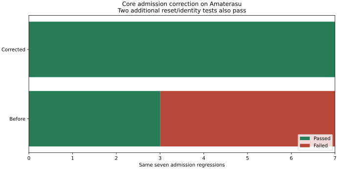

# Core admission: jóváhagyott javítás és Amaterasu-verifikáció

Kezdés: 2026-09-05 19:21 CEST. Ellenőrzött termékcommit:
`8a0c49d4f1cf63deabaa2f15ce147508ef02f598`.
Jóváhagyás: `APPROVED-CORE-EDIT: distributed-admission-monotone-resume`, felhasználói
chat; turn ID nem hozzáférhető. Branch: `audit/core-distributed-semantics-2026-09-05`.

**A négy reprodukált hiba javult.** Ugyanaz a hét public-API eset mind sikeres;
a resync utáni bootstrap-/azonosságmegőrzés két új tesztje is sikeres. A teljes
Core release csomag 366 sikeres, 0 sikertelen, 7 korábban is ignored tesztet ad.
A formázás, workspace/all-target Clippy, CLI, CBOR corpus és benchmark smoke is
sikeres az Amaterasun tiszta commitból épített képen.



[Gépi eredmények](distributed-admission-fix/results.json),
[végső teljes napló](distributed-admission-fix/final.log),
[aktuális követelménymapping](distributed-admission-fix/traceability.tsv).

## Mi változott?

A meglévő `TransactionAssembler` most elutasítja a komponensenként
összehasonlíthatatlan célverziót még staging előtt. A privát `has_current_version`
jelző megkülönbözteti az üres bootstrappet a már helyreállított verziótól, ZERO
esetében is. Azonos, létező verzióhoz ismeretlen commit-azonosság mellett
`ReplayOutsideWindow` érkezik, állapotcsere nélkül. Ismert azonosság esetén a
korábbi duplicate/conflict szabály marad érvényes. Reset megőrzi a jelzőt és a digestet.

Védett módosítás: kizárólag `hymeko_core/src/ir_stream/assembler.rs`, a jóváhagyott
scope szerint. Nincs publikus API-, wire-, függőség-, Cargo-lock-, fixture- vagy
WGPU-módosítás. A [tesztforrás](../hymeko_core/tests/ir_stream_admission.rs) a korábbi
audit-probe áthelyezése, két reset-teszttel; `autotests=false` mellett a meglévő
`tests/mod.rs` regisztrálja. Nem maradt második, párhuzamos tesztimplementáció.

A három meglévő szemantikai dokumentum az új runtime-állapotot jelzi. Az eredeti
[auditjelentés](2026-09-05-distributed-semantics.md), FAIL-logok és manifest az
`1befefb` revízió történeti bizonyítékai. A régi probe-útvonal is ebből a Git-revízióból
olvasható; a jelenlegi forrás a fenti Core-teszt. A régi manifestet nem írtam át.

A bizonyítékcommit előtt a telepített contract-tool már a provider `5517e6b`
revízióját használta. Emiatt a korábbi index nem ment át a gate-en. A felhasználó
kért provider-frissítésének részeként a `SYMBOLS.md` ezzel a pontos revízióval
újragenerált: 614 szimbólum, 3 helyett 5 nyelv szerint elkülönített csoport.
Ez generátorváltozás, nem Rust API-változás; a hook/CI pin átvezetése külön commit.

## Ellenőrzési lánc

| Réteg | Eredmény | Idő / memória |
|---|---|---|
| Candidate, új kilenc teszt | 9 PASS | 25,71 s fordítással; 511328 KiB max RSS |
| Candidate, meglévő assembler-suite | 37 PASS / 1 ignored | 3,84 s fordítással |
| Candidate, teljes Core + fmt + Clippy | PASS | [Napló](distributed-admission-fix/candidate.log) |
| Tiszta commitból épített SDK, `all` | PASS, exit 0, OOM=false | 82,223 s teljes konténeridő |
| Végső Core release tesztek | 366 PASS / 7 ignored | 20,95 s; 3069064 KiB max RSS |
| Végső Clippy, workspace/all-target | PASS, warnings denied | 21,86 s; 815864 KiB max RSS |
| Változatlan Lean-modell | 19 tétel PASS, exit 0 | 1,002 s; 278,691 MiB working set |

A végső futás friss, üres `hymeko-distributed-fix-clean-target-20260905` volume-ot
használt. A konténer és a meglévő dedikált builder limitje 16 GiB, hozzáadott swap
nélkül, 6 CPU. Végső cgroup-csúcs: 3685134336 bájt (kb. 3,43 GiB), page cache-sel
együtt; ez nem process RSS. [Inspect](distributed-admission-fix/final-container.json).
A Windows Lean-guard 2048 MiB working setet mintavételez 100 ms-onként; nem kernelkvóta.

Az ignored esetek változatlanok: assembler taxonomy dump; négy CBOR memory/fixture
diagnosztika; corpus-lowering benchmark; incidence-vs-clique benchmark. Teljes
nevük és okaik a végső logban szerepelnek. Nem futott optional IPC/Arrow kampány,
GPU-teszt, hálózati consumer-kísérlet vagy elosztott throughput-mérés.

## Formális állítás és korlátja

A [Lean-forrás](../docs/verification/unified-ir/distributed-semantics.lean) nem
változott. Mind a 19 tétel és axiómafüggősége újra ellenőrzött:
[log](distributed-admission-fix/lean-check.stdout.log),
[erőforrásadat](distributed-admission-fix/lean-check.memory.json).
Nincs saját axióma vagy befejezetlen bizonyítás; standard `propext` és `Quot.sound`
szerepelhet. A független kódreview az admission-guardok sorrendjét és a staging
limitek megőrzését is ellenőrizte, blokkoló eltérés nélkül.

Ez absztrakt admission-bizonyítás és konkrét Rust-regressziós megfelelőség. Nem
automatikus Rust-refinement, teljes IR-deltaalkalmazás, tartós atomicitás, digest-binding,
kriptográfiai ütközésállóság, hálózati liveness vagy GPU-élettartam bizonyítása.

## Reprodukció, proveniencia, folytatás

SDK: `hymeko-core:8a0c49d4f1cf63deabaa2f15ce147508ef02f598`;
image ID: `sha256:64fc9b80168e1c278723cfe49272be22a545662bc5b3c46e71a2515279ab6a78`.
[Buildmetadata](distributed-admission-fix/core-image-build.json),
[buildlog](distributed-admission-fix/image-build.log),
[forráshashek](distributed-admission-fix/final-source.sha256).
Rust 1.97.1 / Debian 12 SDK, Amaterasu Linux 7.0.0-28-generic; a host hardver és
a Docker-recept a [korábbi Core-jelentésben](2026-09-05-core-amaterasu.md) szerepel.

```sh
docker run --init --network none --memory 16g --memory-swap 16g --cpus 6 \
  --mount type=volume,source=YOUR_EMPTY_TARGET,target=/workspace/core/target \
  hymeko-core:8a0c49d4f1cf63deabaa2f15ce147508ef02f598 all
```

A source bundle a pontos commitot vitte Amaterasu tiszta checkoutjába; nem laptop
path-dependencyt használt. Remote munkakönyvtár:
`/home/kyberszittya/hymeko-distributed-admission-fix-20260905`; végső konténer:
`hymeko-distributed-fix-final-20260905`, leállt állapotban. A kinyert assembler és
regressziós forrás Git-bájtazonosságát a [manifest](distributed-admission-fix/artifact-manifest.json)
és ellenőrzési adatai rögzítik. A manifest tartalmazza a teljes fájllistát és
hozzáadott/eltávolított sorszámokat, önmaga kivételével.

Rollback: az `8a0c49d` scoped termékcommit visszavonása; a baseline bizonyítékok
megmaradnak. Nincs push, merge vagy tag ebben a javításban. A felhasználó új kérései
szerint ezután a friss `hymeko/hymeko` szerződés betöltése, a kapcsolódó csomagok
egységes, aktuális revíziói és a fogyasztói ellenőrzések következnek; tagek ezek után.
