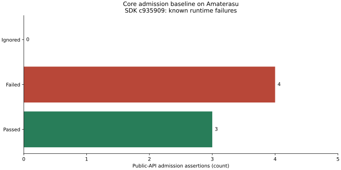

# Core: elosztott frissítések szemantikája és formális verifikációja

Kezdés: 2026-09-05 17:10 CEST. Jelentés: 2026-09-05 19:09 CEST.

**Állapot: a specifikáció és az absztrakt bizonyítás elkészült; a Rust-javítás
jóváhagyásra vár.** A jelenlegi Core két hibacsaládját négy sikertelen public-API
teszt reprodukálja Amaterasun. A normatív Lean-modell 19 tétele sikeres. A két
eredmény különböző tárgyra vonatkozik: a modell bizonyítása nem javítja meg és nem
verifikálja automatikusan a Rust-megvalósítást.

## Eredmény és hatókör

| Ellenőrzés | Eredmény | Bizonyíték |
|---|---|---|
| Lean 4.19.0, 19 név szerinti tétel | PASS, exit 0 | [Kernel/axióma napló](distributed-semantics/lean-check.stdout.log) |
| Lean negatív kontroll: incomparable-guard kikapcsolva | Elvárt FAIL, exit 1; a konkrét elutasítási állítás hamis | [Napló](distributed-semantics/lean-negative-control.stdout.log) |
| Eredeti Rust-probe az Amaterasu-képen | 3 PASS / 4 FAIL / 0 ignored, exit 101 | [Eredeti napló](distributed-semantics/admission-baseline.log) |
| Összevont tesztkód, pontos hibaváltozatokkal, ugyanazon képen | 3 PASS / 4 FAIL / 0 ignored, exit 101 | [Végső napló](distributed-semantics/admission-current.log) |
| SYMBOLS provider-ellenőrzés | PASS, exit 0 | [Eredmény](distributed-semantics/contract-symbols.json) |
| Token-duplikáció | PASS: 402 clone / 7769 sor; baseline 403 / 7800 | [Napló](distributed-semantics/contract-duplication.log) |
| Probe rustfmt; javasolt patch alkalmazhatósága | PASS | `rustfmt --edition 2024 --check ...`; `git apply --check ...` |
| Terv PDF | PASS, 2 oldal, Amaterasu `pdflatex` | [Buildnapló](distributed-semantics/plan-build.log) |
| Védett Core-forrás, Cargo, fixture, WGPU | Nem módosult | Üres célzott Git-diff |



A diagramot a [plot_admission.py](distributed-semantics/plot_admission.py) az
eredeti nyers tesztnaplóból állítja elő; [számszerű adatok](distributed-semantics/admission-counts.json).
Nincs animált rendszerfutás: ez determinisztikus admission-ellenőrzés, nem
szimuláció, hálózati terhelés vagy időben lejátszott worker-kísérlet.

## Reprodukált hibák

Mindegyik teszt a valódi `EnvelopeDraft → encode_message → validate_message →
TransactionAssembler::apply` útvonalat használja. A section-t hordozó üzenetekben
üres, nyolcbájtos section-tábla van; ez érvényes framing, de nem teljes IR-snapshot.
A probe nem épít második assemblert vagy consumer-oldali IR-t.

| Eset | Elvárt eredmény | Megfigyelt eredmény |
|---|---|---|
| Resume `(2,2,2,0)`, azonos cél, korábbi digest nélkül | `ReplayOutsideWindow`, állapotmegőrzés | Új `Committed` |
| Snapshot `(2,2,2,0) → (1,3,3,0)` | `IncoherentVersionBump`, topológia nem csökken | `Committed`, topológia 2 → 1 |
| Delta `(2,2,2,0) → (2,1,3,0)`, pontos base | `IncoherentVersionBump`, súlyverzió nem csökken | `Committed`, weights 2 → 1 |
| Resume ZERO, ZERO cél, korábbi digest nélkül | `ReplayOutsideWindow` | Új `Committed` |
| Friss, üres assembler ZERO snapshotja | `Committed` | PASS |
| Resume után domináló `(3,3,3,0)` snapshot | `Committed` | PASS |
| Delta eltérő base-ről | Pontos `StaleBase`, verzió/digest megőrzése | PASS |

A gyökérokok a meglévő assemblerben vannak. A `begin` kiszűri a teljesen régi
célokat, de nem utasítja el a komponensenként összehasonlíthatatlan célokat.
Az equal-version újraellenőrzést pedig csak ismert digest mellett kapcsolja be,
miközben `resuming_at` nem állít helyre digestet. Emiatt a dokumentált
ismeretlen-replay ág folytatáskor nem érhető el.

## Elkészített, még nem alkalmazott javítás

[Implementációs patch](distributed-semantics/proposed-admission-fix.patch) és
[konkrét teszt-/rollback-terv](distributed-semantics/proposed-core-edit.md).
Egyetlen védett fájl: `hymeko_core/src/ir_stream/assembler.rs`.

1. Privát `has_current_version` jelző különbözteti meg a friss bootstrappet a
   már helyreállított verziótól, ZERO esetében is.
2. A cél minden komponensének dominálnia kell az aktuális verziót; egyébként a
   meglévő `IncoherentVersionBump` visszaszinkronizálást kér.
3. Azonos, már létező verzió esetén digest nélkül is újraellenőrzés történik;
   hiányzó azonosság mellett `ReplayOutsideWindow`, állapotcsere nélkül.

Nincs új publikus API, wire-mező, hibaváltozat, függőség vagy hash-módosítás.
A [probe](distributed-semantics/admission_probe.rs) a jóváhagyás után egyetlen
forrásként kerülhet a meglévő Core integrációs tesztharnessbe. Az assembler-suite,
teljes Core release teszt és workspace Clippy **nem futott újra**: javított
termékkód még nincs. Nem fedtem el a négy ismert hibát más zöld tesztekkel.

**CORE.YAML érintett elemek most: üres lista.** A korábban bekért
`APPROVED-CORE-EDIT: distributed-admission-monotone-resume` token még nem érkezett
meg. A [manifest](../CORE.YAML) `approval.mechanism` része előírja:
“A change may proceed only after the user replies in the chat with the literal
token”. A korábbi Graph-token nem általánosítható erre a slugra. Az alkalmazható
patch elkészítése és ellenőrzése megtörtént; a védett szerkesztés maradt függőben.

## Mit bizonyít a Lean-modell?

Forrás: [distributed-semantics.lean](../docs/verification/unified-ir/distributed-semantics.lean).
Követelménymapping: [traceability.tsv](distributed-semantics/traceability.tsv),
kanonikus magyarázat: [requirements.md](../docs/verification/unified-ir/requirements.md#distributed-admission-verification--2026-09-05).

- Komponensenkénti részleges rendezés: reflexivitás, tranzitivitás, antiszimmetria.
- Elfogadott telepítés célja dominálja a korábbi verziót; egy lépés és tetszőleges
  véges replay nem csökkenti azt.
- Elutasítás és már létező azonos verzió megőrzi a teljes **modellezett** állapotot.
- Azonos tranzakció kétszeri alkalmazása állapot szerint idempotens; egy közvetlen
  ismétlés elhagyható a listából. Ez nem tetszőleges prefix-kettőzés bizonyítása.
- Stale delta-base és incomparable cél nem települ.
- Ugyanaz a koherens snapshot ugyanarra a modellezett állapotra visz két replikát,
  ha a célja mindkettő verzióját dominálja, és mindkettőtől különbözik.
- Négy zárt példa kapcsolódik a resume/incomparable/ZERO probe-okhoz; a friss ZERO
  elfogadása kizárja a mindent elutasító, triviális megoldást.

A 19 tétel mindegyikére lefutott a `#print axioms`. A használt standard axiómák
`propext` és `Quot.sound`; nincs saját deklarált axióma, `sorry`, `admit` vagy
`sorryAx` a sikeres bizonyításban. A szándékosan hibás kontroll naplójában a
Lean-hibák következményeként van `sorryAx`; az nem elfogadott bizonyítási eredmény.
Az őrfeltétel kikapcsolása után a `decide` konkrétan hamisnak minősíti az
incomparable-elutasítási példát, tehát a kontroll nem csupán stílus-/szintaktikai hiba.

A Lean kernel általi ellenőrzés értelmezéséhez: [Lean 4.19 hivatalos dokumentáció](https://lean-lang.org/doc/reference/4.19.0/The-Type-System/Propositions/).

**Bizonyítási korlátok:** a verziókomponensek `Nat` értékek, így az összehasonlítás
absztrakciója lefedi a `u64` tartományt, de nincs növelési/túlcsordulási bizonyítás.
Az identity és payload egymástól független opaque címkék: azonossági címke
egyezése nem bizonyít tartalomegyezést. Nincs digest-binding vagy kriptográfiai
ütközésállósági tétel. A modell teljes tranzakcióból dönt; nincs benne wire- és
sequence-gép, staging-limit, reset, valós deltaalkalmazás, tartós checkpoint,
konkurens publikáció, GPU-élettartam vagy hálózati liveness.

Az idempotencia nem garantál `ExactDuplicate` választ: egy előrelépő delta
ismétlése `StaleBase` is lehet, változatlan állapot mellett. A snapshot-tétel nem
rendezi azonos verzión már eltérő állapotú replikák konfliktusát, és nem bizonyít
delta/snapshot ekvivalenciát vagy eventual delivery-t. A strukturális v1 hash
nem fedi le az összes szemantikai mezőt, ezért nem teljesállapot-azonosító.

## A specifikáció frissítése

A meglévő `unified-ir-architecture.md` G.1–G.6 és a
`hypergraph-synchronization.md` verzió-, replay-, helyreállítási és elosztott
végrehajtási részei pontosításra kerültek. A korábbi feltétel nélküli konvergencia,
verzióból következtetett azonosság, verzió-only tartós állapot és framingből
következtetett telepítés helyére ellenőrizhető, feltételes követelmények kerültek.

A műveleti kommutativitás sem következik pusztán eltérő célnevekből: olvasási és
írási függőségeket, stabil címzést és a szemantikai sorrendet is vizsgálni kell.
Az `AddDecl` létrehozási sorrendje `LocalId`-t befolyásolhat; a referencia-darabszám
ellenőrzése pedig nem zár ki azonos hosszúságú átrendezést. Ezek nem új merge-API-k,
hanem a régi táblázat bizonyítatlan állításainak korlátozásai.

Az „elosztott végrehajtás/modellfrissítés” értelmezést a beszélgetés alapján
használtam; az algebrai disztributivitásra vonatkozó opcionális pontosító kérdésre
még nincs válasz. Nincs új aggregációs nyelvtan vagy lebegőpontos átrendezési jog.
Az operátorok algebrai törvényeit az adott numerikus tartományon kell igazolni.

## Ownership és meglévő bizonyítások

Core: kanonikus IR, codec, verzió és assembler. Chordex: opaque transzport.
Consumer: feladatelosztás, eredményátvétel és telepítési kompozíció. Numerikus és
gráfalgoritmusok a meglévő Nagare/Graph tulajdonosnál maradnak.

A független, csak olvasó audit a meglévő bizonyítási helyeket is felderítette.
A `hymeko_framework/proofs` üres, nem Git-repó. A külön `gsphf_repo` lokális,
nem verziózott Lean-anyaga strukturális hipergráf-tételekről szól; nem Core
replay-bizonyítás. A történeti monorepó SymPy/Z3 ellenőrzései sem implementációs
refinementet bizonyítanak: például a kereszt-nézeti modell a rendererek kanonikus
leképezéssel való azonosságát feltevésként használja. A Transformation Lean-emitter
`True := by trivial` scaffoldja nem alkalmas e követelmények verifikálására.
Ezekhez nem nyúltam, és új Lean-/mathlib-függőséget nem telepítettem.

Az önálló Amaterasu-kísérlet következő lépése ugyanazon független munkacsomag
helyi, távoli és megosztott futtatása: teljes idő, átvitt bájtok, szerializáció,
memória, eredményazonosság és megszakított worker helyreállítása. A feladatazonosítót
pontos inputhoz, paraméterekhez, algoritmusrevízióhoz és seedhez kell kötni.
A Chordex legutolsó snapshotot megtartó pending slotja nem tartós job queue és
nem telepítési visszaigazolás. Hiperél-particionálás/halo és numerikus
redukció-átrendezés külön mérési/bizonyítási feladat. Elosztott gyorsulást nem mértünk.

## Proveniencia és reprodukció

Saját worktree: `D:/hnnwork/distributed/core`, branch
`audit/core-distributed-semantics-2026-09-05`, alap
`4a243ede85b7dd1f488bc9c68a46086a8638e39c`. A termékkód az audit során változatlan;
az új/módosított dokumentumokat és evidence-fájlokat a manifest sorolja fel.
Az eredeti IDE-worktree és a korábbi audit-/Docker-worktree nem szerkesztési cél.
Az eredeti kérés helyi, tematikus commitokat engedélyez; push/merge/release nem történik.

Amaterasu SDK: `hymeko-core:c935909ec97bcb01e9dafd52d64227ee9df81e4b`, image ID
`sha256:a26c1d9cec52094054fa31cbb482fedb0a57562149b3a9b6cfdb25e1f79e1d5c`.
A termékkód és lock azonos a feladat alapjával. Read-only build-volume:
`hymeko-core-clean-target-20260905`; könyvtár
`/workspace/core/target/release/deps/libhymeko.rlib`. A források és a használt rlib
hash-ei: [runtime-provenance.log](distributed-semantics/runtime-provenance.log).
Rust/Cargo 1.97.1, Debian 12 SDK, Linux 7.0.0-28-generic.
A mai host/dependency környezet a változatlan [Core Docker-jelentésben](2026-09-05-core-amaterasu.md)
és annak `host-environment.log` / Cargo-lock adataiban szerepel. GPU nem vett részt.

Eredeti konténer: `hymeko-distributed-admission-20260905`;
végső probe: `hymeko-distributed-admission-refactored-20260905`.
Mindkettő leállt, exit 101, `OOMKilled=false`, hálózat nélkül, 2 CPU,
2 GiB memória és ugyanekkora memory+swap limit, tehát hozzáadott swap nélkül.
[Eredeti inspect](distributed-semantics/admission-baseline-container.json),
[végső inspect](distributed-semantics/admission-current-container.json).
A remote könyvtár `/home/kyberszittya/hymeko-distributed-semantics-20260905`.
Nincs futó ellenőrzés vagy háttérben várakozó kísérlet.

```sh
rustc --edition=2024 --test /probe.rs \
  --extern hymeko=/workspace/core/target/release/deps/libhymeko.rlib \
  -L dependency=/workspace/core/target/release/deps -o /tmp/admission-probe
/usr/bin/time -f 'resource elapsed_s=%e max_rss_kib=%M exit=%x' \
  /tmp/admission-probe --nocapture --test-threads=1
```

Windows Lean: `4.19.0`, toolchain commit `6caaee842e94`; `Std` import, nincs Mathlib.
A [memory JSON](distributed-semantics/lean-check.memory.json) rögzíti az executable
hashét, pontos parancsát, könyvtárát és a monitor beállításait.

```powershell
$measurement = & ./scripts/dev/measure_peak_memory.ps1 `
  -Executable C:/Users/kyber/.elan/toolchains/leanprover--lean4---v4.19.0/bin/lean.exe `
  -ArgumentString docs/verification/unified-ir/distributed-semantics.lean `
  -MaxWorkingSetMiB 2048 -LogPrefix reports/distributed-semantics/lean-check
if ($measurement.exit_code -ne 0) { throw 'Lean failed' }
if (Select-String reports/distributed-semantics/lean-check.stdout.log -Pattern 'sorryAx') {
  throw 'Unfinished proof dependency'
}
```

Provider: a már telepített `hymeko/hymeko@515f285886495fdcb5866f2ddafe1889a99757ab`,
`contract-symbols --root . --check` és `contract-duplication --root .`.
Sem a provider, sem a duplication baseline nem módosult. A régebbi CI-pin
integrációja továbbra is a következő dependency/CI fázis része.

## Erőforrások és sikertelen próbálkozások

| Futás | Falióra | Megfigyelt process-memóriacsúcs | Limit |
|---|---:|---:|---|
| Végső Lean | 0,900 s | 275,852 MiB working set | 2048 MiB, 100 ms mintavételű guard |
| Lean negatív kontroll | 0,949 s | 279,578 MiB working set | Ugyanaz |
| Eredeti Rust tesztbináris | 0,00 s felbontás szerint | 2492 KiB RSS | 2 GiB konténer |
| Végső Rust tesztbináris | 0,00 s felbontás szerint | 2588 KiB RSS | 2 GiB konténer |

A Rust-adat a tesztbinárisra vonatkozik, nem a fordításra vagy a teljes konténer
memóriájára; a 0,00 nem nulla költség. Ezek nem throughput-benchmarkok.
A Windows guard mintavételezett megfigyelés, nem kernelkvóta; virtuális címtérre
nem alkalmaztunk limitet. A munkafázis faliórája meghaladta a kezdeti 45–90 perces
ETA-t; ezt nem szabad a másodperc alatti bizonyítási futások idejével összekeverni.

Megtartott sikertelen próbák: az első rustc parancs hibás rlib-útvonalat használt
([napló](distributed-semantics/admission-compile-attempt.log)); a telepített Lean
elutasította a megkísérelt belső memóriaopciót
([napló](distributed-semantics/lean-option-attempt.log)). A tényleges Lean-limit
ezért a meglévő RSS-guard. A kezdeti tesztismétlés 404 clone / 7821 sort eredményezett;
a [kapuhibát](distributed-semantics/contract-duplication-attempt.log) közös probe
segédmetódusokkal oldottam meg, nem baseline-emeléssel. Mind a hét név szerinti
teszt megmaradt. Az eredeti probe bájtjai a jelenlegiből és a
[refaktor-diffből](distributed-semantics/probe-refactor.patch) rekonstruálhatók;
[mindkét forráshash](distributed-semantics/probe-provenance.json) egyezik a remote fájlokkal.

## Fájlok, integritás és folytatás

A teljes fájllista, SHA-256, bájtméret és hozzáadott/eltávolított sorszám a
[manifestben](distributed-semantics/artifact-manifest.json) található. A manifest
önmagát nem hash-eli. Új függőség: nincs. A `.gitattributes` kiegészítése őrzi az
új evidence/terv bájtjait; a régi Docker-manifest saját alaprevíziójára érvényes,
nem az azóta bővült `.gitattributes` legújabb változatára.

[Integritásellenőrzés](distributed-semantics/integrity-check.json): a régi
platform-audit mind a 417, a Docker-audit mind a 60 bejegyzése egyezik az alaprevízió
Git-bájtjaival. A platform-evidence a jelenlegi lemezen is változatlan. Az új
worktree-ben három régi, nem evidence szövegfájl (`.dockerignore`,
`docs/core-container.md`, `tools/ci/Dockerfile`) checkout miatti CRLF-sorvége eltér
a régi Docker-manifest LF-bájtjaitól; LF-re értelmezve a hashek egyeznek, Git-diffjük
üres. Ezeket nem írtam át. A negyedik eltérés a fent jelzett `.gitattributes` bővítés.
A futtatott assembler/version/Cargo-lock hashei pontosan egyeznek az alaprevízióval.

Rollback: az audit/specifikáció commitjának visszavonása csak ezen a branchen;
a még nem alkalmazott termékpatchnek nincs futásidejű hatása. Jóváhagyás után a
forrásjavítás és a tesztharness külön, tokennel hivatkozott commitot kap, a
négy eredeti hibára PASS szükséges. Ezután jön a korábban kért dependency/CI
integráció, a valódi browser modellfrissítés és az Amaterasu consumer-kísérlet.
A formális IR-alkalmazás, durable checkpoint, multi-writer/CRDT és halo-protokoll
ezzel a részfeladattal nem tekinthető késznek.
