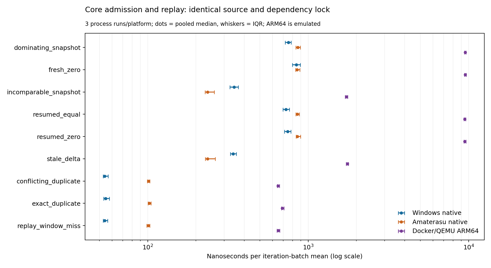

# Distributed Core verification and platform benchmarks

Started: 2026-09-06T04:28:31+02:00
Status: technical verification and three-platform measurements completed on
`feat/core-distributed-verification-benchmarks`, base `92383b38`. Local deletion of
archived duplicate data was blocked by automatic approval review (details below).

Scope: Core admission/replay semantics, formal model and implementation conformance,
then identical Criterion workloads on Windows, native Amaterasu and Docker/QEMU ARM64.
The P5/P6/P7 production transaction/publication/apply roadmap is not claimed implemented
by these admission checks. The unmerged executable-model-contract-v3 branch is a
separate change, not silently included. No new checkout or worktree.


Final result: **419 Core tests passed, 7 ignored; 23 Lean theorems checked; 52,812
model-derived conformance cases per platform; 11 admission tests passed on both
native Amaterasu and ARM64 Docker/QEMU.** All 81 accepted benchmark cells
(9 workloads x 3 repetitions x 3 platforms) completed successfully. Clippy,
formatting, symbols and the unchanged duplication gate passed. No production
source or dependency lock changed.



[Raw archive](distributed-verification-benchmarks/benchmark-raw.zip),
[pooled statistics](distributed-verification-benchmarks/platform-summary.csv),
[per-run statistics](distributed-verification-benchmarks/per-run-summary.csv),
[process resources](distributed-verification-benchmarks/process-resources.csv).

## Discovery

```text
DISCOVERY LEDGER - distributed verification and three-platform measurements
  find:    existing distributed plan, Lean model, admission tests, ir_stream_bench
  grep:    replay/resume -> TransactionAssembler and Criterion groups
  symbols: SnapshotVersion, TransactionAssembler -> existing Core owners
  read:    admission fix report, roadmap, Dockerfile, core.sh, measurement helpers
  verdict: EXTEND the existing model, tests, benchmark and Docker recipe;
           generated oracle cases and measurement outputs are new evidence.
```

## Initial evidence and interpretation

The prior admission fix has nine passing public-API regressions and 19 Lean theorems;
Core main now has 417 passing tests after branch consolidation. No distributed speedup,
durable exactly-once installation, arbitrary delta application or network liveness was
proved by that work. Version axes denote artifact dependencies, not replica vector clocks.

Amaterasu: x86_64 Linux, 16 logical CPUs, about 32 GiB RAM; existing bounded Core builder,
SDK images and the existing clean Core checkout are available. No ARM64 binfmt handler
or qemu-aarch64-static is currently installed on the host. Plan an explicit interpreter
inside a bounded container, reusing native cross-compilation and avoiding global setup.

Docker documents that QEMU emulation is substantially slower for CPU-intensive work;
use cross-compilation for build cost and interpret emulated runtime separately from
native ARM hardware. [Docker multi-platform guidance](https://docs.docker.com/build/building/multi-platform/).
QEMU user mode executes foreign-architecture userspace on the host OS, not a hardware
board model. [QEMU user-mode documentation](https://www.qemu.org/docs/master/user/index.html).

Plan: ../docs/plans/2026-09-05-distributed-semantics/plan.tex (continuation section).

## Verified implementation checkpoint f276a08 (before the final added regression)

23 Lean 4.19.0 theorems pass (standard propext/Quot.sound only). The added theorem
`committed_replay_after_suffix` preserves modeled state when an installed transaction
is replayed after any finite suffix. It does not make rejected transactions permanent.
The deliberately false resumed-zero bootstrap theorem is rejected by the kernel.
The monitored positive check used 285.457 MiB peak working set and 1.064 seconds.

The model generates 26,406 cases over four ternary version axes. The public Rust
encode/validate/assembler path agrees for all cases under both [0,1,2] and
[0,1,u64::MAX] order-preserving embeddings: 52,812 cases. Checks include typed
outcomes and retained version/digest. This is finite conformance, not Rust refinement.
Oracle regeneration reproduced identical bytes; hashes/counts are in oracle-provenance.json.

Windows: full Core release suite **418 passed / 7 ignored**, all-target/all-feature
Clippy with denied warnings, fmt, symbols and duplication passed. Duplication remains
422 clones / 8163 lines / 197 files. Selected benchmark preflights pass. No production
source, parser pin or lockfile changed. Timed measurements are still pending.

The cross-toolchain image is built natively with the ARM64 Rust standard library,
GNU cross linker and libc development sysroot. The first candidate lacked the libc
headers/startup objects; this was corrected before cross compilation. The final
image is `sha256:326930c465e5d47623a3de3d5e0253d521b91f144b336422fad32529ca567270`.
BuildKit retains its existing six-CPU/16-GiB quota; Cargo uses four jobs. No host
binfmt registration, privileged setup or host package installation was performed.

## Research interpretation and next falsifiable steps

The four version components track Core artifact dependencies. They do not encode
process identities or message causality. Lamport's event order is defined from
local events and send/receive relations; componentwise order alone does not
supply those missing observations. This is our inference from the Core model
compared with [Lamport's original event-order definition](https://lamport.azurewebsites.net/pubs/time-clocks.pdf).

The current single-writer admission gate rejects incomparable targets. It has no
join/merge operation over two independently edited semantic IR states. Therefore
it does not establish coordination-free multi-writer convergence, whose contract
requires replicas receiving the same updates to converge. This distinction follows
from the actual model and the [CRDT authors' definition](https://arxiv.org/abs/1805.06358).
No novelty claim or new algebra is made by this campaign.

| Next Core obligation | Discriminating evidence | Present status |
|---|---|---|
| Bind accepted envelope to complete canonical semantic state | Decode the actual payload, validate coherence, compare canonical semantic digest and content under corruption/replay | Existing codec/digest owners available; not connected by this admission campaign |
| Publish a transaction atomically to readers | Fault injection before/after publication; every reader observes one version with matching derived artifacts | Native transaction/publication roadmap still open |
| Distinguish installed work from received data | Crash/restart between receive, apply, publish and acknowledgment; restore persisted identity and full state | Not established by volatile admission metadata |
| Independent distributed jobs | Same fixed work and exact inputs, end-to-end transfer/queue/compute time, result equivalence and interrupted-worker recovery | Future experiment; current results are three-platform microbenchmarks |
| Multi-writer semantic merge or hyperedge partition exchange | Specify join/conflict policy or halo ownership first; prove invariants and measure cut cardinality/communication | No current implementation or speedup claim |

The ordering is deliberate: complete-state installation/publication is the next
technical boundary to close before claiming a reliable distributed execution
framework. The present work adds a kernel-checked safety theorem, independent
finite implementation conformance and an executable portability/measurement path.

## Measurement protocol

The executable sources and dependency lock are identical across the three platforms;
`source-provenance.json` records Git-normalized input bytes and binary hashes are
retained in process/build evidence. Windows was initially built at `f276a08`;
`18f9908` adds one integration test and CI/docs only. The benchmark, production
source and lock are byte-identical between these checkpoints. All final platform
correctness tests use the added nonadjacent replay regression.

Nine fixed cells: three validated replay decisions, four two-frame admission
transactions and two one-frame early rejections. Assembler limits are strict for
new admission cells. Each has an outcome/version/digest preflight. Criterion 0.8.2
uses three-second warmup and three-second requested measurement, 50 samples for
admission and 100 for replay. The selected regex and all remote commands are
retained in `remote-measure-commands.py.txt`. Each process runs cells sequentially;
native Linux and ARM64 campaigns do not overlap on Amaterasu. Rayon is set to four,
but these admission operations are sequential, not a four-worker speedup test.

Windows accepted runs are **1, 2, 4**. Run 3 overlapped a local integration-test
compilation, is retained as excluded evidence, and was replaced after local gates
finished. No other benchmark or build from this campaign overlaps accepted runs
on the same host. Ordinary host services remain active; no thermal/frequency lock
or exclusive machine reservation is claimed.

Windows uses the existing 100-ms working-set monitor and 16-GiB userspace guard.
Native Amaterasu executes the x86-64 ELF directly on the host, in a user systemd
scope with MemoryMax=16G, MemorySwapMax=0 and CPUQuota=400%; GNU time records actual
process peak RSS. ARM64 uses an ARM64 Debian image, ARM64 ELF and an explicitly
mounted native static QEMU interpreter, Docker four-CPU/16-GiB/no-swap limits and
network disabled. QEMU process VmHWM and cgroup memory.peak are sampled every
100 ms; the final poll window may be missed. Container exit and OOM status are
retained. Cgroup memory includes cache and is not process RSS. The QEMU harness
uses no global binfmt registration or privileged container.

Admission construction is outside the timed closure; validation, state transition
and closure-owned assembler destruction are inside. Criterion batches retain
multiple assemblers. Their peak RSS therefore measures the complete benchmark
process, not a per-transaction working set. Returned outcome destruction follows
Criterion's batched timing semantics. Samples are **iteration-batch means**;
quartiles and worst values must not be interpreted as individual-request p95/p99.

The extended existing PowerShell reporter reads raw samples. An independent Python
statistics check reproduces its medians, inclusive quartiles and maxima. Aggregated
platform tables pool the three accepted runs with equal sample counts per cell;
per-run summaries preserve between-process variation. No A/B optimization or 10%
regression claim is made across different hosts or QEMU.

## Results

All cells below are nanoseconds: **median [Q1, Q3]; worst batch mean**. Each
admission cell pools 150 samples, each replay cell 300. These samples are not
independent requests. The figure is also available as
[SVG](distributed-verification-benchmarks/platform-latency.svg) and
[PDF](distributed-verification-benchmarks/platform-latency.pdf).

| Workload | Windows native | Amaterasu native | Docker/QEMU ARM64 |
|---|---:|---:|---:|
| dominating_snapshot | 752.3 [719.3, 783.9]; 1017.4 | 861.1 [839.2, 892.2]; 1051.1 | 9542.7 [9426.3, 9645.0]; 10915.3 |
| fresh_zero | 843.2 [797.8, 895.0]; 1194.5 | 854.5 [834.1, 886.4]; 965.8 | 9521.1 [9409.3, 9655.6]; 10871.2 |
| incomparable_snapshot | 345.7 [325.1, 366.5]; 4846.9 | 236.6 [228.2, 259.9]; 323.1 | 1732.6 [1704.6, 1762.5]; 1972.8 |
| resumed_equal | 726.4 [696.0, 764.6]; 987.2 | 855.3 [838.1, 881.6]; 957.3 | 9468.5 [9370.8, 9594.9]; 10143.9 |
| resumed_zero | 744.4 [712.9, 781.4]; 1476.3 | 856.3 [840.7, 898.2]; 1090.4 | 9463.7 [9351.8, 9623.9]; 10783.1 |
| stale_delta | 340.9 [327.3, 356.7]; 563.2 | 236.4 [229.0, 263.8]; 355.9 | 1754.5 [1725.5, 1780.4]; 2016.1 |
| conflicting_duplicate | 54.0 [52.8, 56.6]; 79.2 | 101.2 [99.6, 103.2]; 114.3 | 649.5 [642.5, 661.7]; 904.0 |
| exact_duplicate | 54.8 [53.1, 57.7]; 78.9 | 102.3 [100.6, 104.8]; 115.3 | 689.7 [680.8, 706.4]; 818.1 |
| replay_window_miss | 54.0 [52.8, 56.2]; 75.6 | 100.7 [98.9, 102.9]; 111.8 | 651.5 [639.1, 665.2]; 812.4 |

| Platform | Host/runtime | Maximum observed process RSS | Per-run wall time |
|---|---|---:|---:|
| Windows | Intel Core Ultra 9 275HX, 24 logical CPUs; Rust 1.97.1 MSVC | 887.750 MiB | 58.897-59.153 s |
| Amaterasu native | AMD Ryzen 7 3700X, 16 logical CPUs; Rust 1.97.1 GNU | 450.574 MiB | 62.556-62.756 s |
| Docker/QEMU ARM64 | Same Amaterasu; Debian ARM64 userspace, QEMU 7.2.22 | 278.766 MiB (sampled QEMU VmHWM) | 88.658-90.134 s |

Replay costs around 54-55 ns on this Windows host, 101-102 ns natively on
Amaterasu, and 650-690 ns under QEMU. Successful two-frame admission costs
0.75-0.84 us, about 0.86 us, and about 9.5 us respectively. This is a measured
platform baseline. It says nothing about network throughput, native ARM silicon,
partition speedup or a complete distributed application. Lower QEMU RSS is not
an ARM memory-efficiency claim: slower iterations change Criterion's batching,
and the processes use different runtimes/allocators.

The final standalone integration harness was rebuilt after the added replay test.
Windows full-suite totals are in `core-gates-final.log`; native/ARM logs in the
raw archive each show 11 passed / 0 failed, including all 52,812 oracle comparisons.
The old 418-test checkpoint is retained as history, not the final total.

## Reproduction, failures and cleanup

`remote-build-commands.txt` and `remote-measure-commands.py.txt` retain executed
commands. They refer to this campaign's existing checkout/volume names; do not
create another clone or worktree. Re-run the bounded cross-build action, identify
its emitted test/bench paths, then reconstruct the task-owned temporary runtime
files before executing the measurement transcript. Completed run directories
must not be overwritten. Windows uses `measure_peak_memory.ps1` with the same
regex and a distinct `CRITERION_HOME` per process. To regenerate tables, extract
`benchmark-raw.zip` into this evidence directory and pass each `criterion` directory
to `criterion_report.ps1 -Baseline new -CriterionRoot ...`. The independent check
validated all **81** per-run summaries against raw samples.

Observed setup errors were resolved without changing production code: the first
benchmark CLI invocation incorrectly included `--release` (Cargo bench already
uses that profile); the initial cross image lacked libc development startup files;
and direct remote Gitea fetch encountered host-key verification failure. Source
transfer instead used a verified Git bundle from the successfully fetched/published
local feature branch into the existing remote checkout. No trust check was disabled
and no key/config was copied into an image. A Windows Store Python shim was bypassed
by selecting the already installed Python 3.12 executable explicitly. Two edited
Markdown files were corrected to UTF-8 before their commit was published.

The first ARM64 containers wrote root-owned result files. After verified archive
transfer, a bounded container corrected ownership of only this task's staging tree,
then the staging tree was removed. Future interactive runs should map the caller's
UID/GID to avoid that cleanup step. Amaterasu has **no remaining campaign containers,
transfer bundle or staging tree**; its existing Core checkout is clean at `18f9908`.
The superseded cross-toolchain image was removed. The reusable final cross-toolchain
image is 2,342,065,215 virtual bytes (including shared base layers); the ARM64 build
cache is 229,493,688 bytes inside the existing Core target volume. That whole volume
is 2,713,324,541 apparent bytes, including prior artifacts. BuildKit layer storage is
shared; no exact reclaimed-byte claim or global cache prune is made. No new worktree,
clone or target volume was created.

The authoritative raw artifact has **776 files in a 392,659-byte ZIP**, each verified
against SHA-256 and original bytes. Automatic approval review rejected both the
combined and explicit-path Windows deletion of the archived raw directories with
`blocked by policy`; no more specific reason was supplied. The 549,051 bytes of
extracted copies remain local, together with the small transfer/preview files in
ignored `target`. They are not duplicated in the published evidence. This is a known
cleanup limitation, not a successful deletion claim.

All work is on the requested feature branch. No main merge or release tag was made.
Rollback uses ordinary reverts of this branch's named commits; existing main and
other repositories were not modified. The next Core implementation milestone is
complete semantic installation and atomic publication, as specified above.
